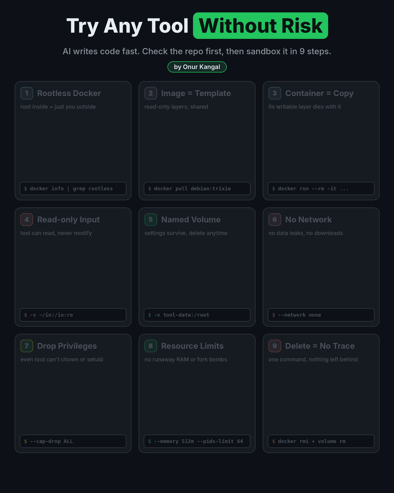
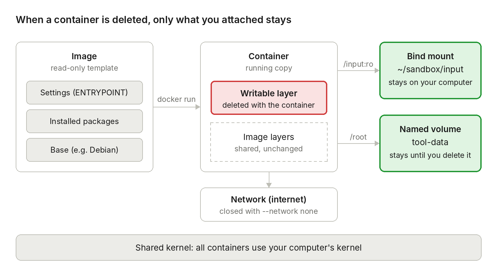

# Trying Open-Source Tools Safely in the AI Era: Inspect, Isolate, Delete

**English** | [Türkçe](README.tr.md)

<p align="center">
  
</p>

**Author:** Onur Kangal · **Last updated:** November 10, 2026 · **License:** [CC BY 4.0](LICENSE) · **Read the story on [LinkedIn](https://www.linkedin.com/pulse/open-source-isnt-trust-signal-anymore-how-i-try-new-tools-onur-kangal-vldlf)**

## Contents

- [1. Introduction: "Open source" alone is no longer a reason to trust](#1-introduction-open-source-alone-is-no-longer-a-reason-to-trust)
- [Inspect first: a 5-minute repository check](#inspect-first-a-5-minute-repository-check)
- [Before you start: setup for your operating system](#before-you-start-setup-for-your-operating-system)
- [2. Core concepts: picture them in your head](#2-core-concepts-picture-them-in-your-head)
- [3. What is rootless Docker, and why does it matter?](#3-what-is-rootless-docker-and-why-does-it-matter)
- [4. Installation and verification](#4-installation-and-verification)
- [5. Your first container and its life cycle](#5-your-first-container-and-its-life-cycle)
- [6. Images: knowing your templates](#6-images-knowing-your-templates)
- [7. Sharing files: bind mounts and volumes](#7-sharing-files-bind-mounts-and-volumes)
- [8. Turning off the network and security flags](#8-turning-off-the-network-and-security-flags)
- [9. Hands-on: installing and running a tool safely](#9-hands-on-installing-and-running-a-tool-safely)
- [10. Dockerfiles and multi-stage builds](#10-dockerfiles-and-multi-stage-builds)
- [Worked example: ncdu from start to finish](#worked-example-ncdu-from-start-to-finish)
- [11. Cleanup and disk management](#11-cleanup-and-disk-management)
- [12. Limits: when is a container not enough?](#12-limits-when-is-a-container-not-enough)
- [13. Troubleshooting](#13-troubleshooting)
- [14. Quick reference card](#14-quick-reference-card)

## 1. Introduction: "Open source" alone is no longer a reason to trust

With AI coding tools, writing software has become both much faster and much easier. One person can write a fully working application in a few days and publish it on GitHub, and thousands of new repositories appear every day. There is a good side to this: lots of new tools worth trying. There is also a bad side: **the assumption "it's open source, so someone must have reviewed it" no longer holds for new repositories.** It has never been this easy for a malicious actor to hide harmful code in the crowd.

This guide answers that problem in two layers:

1. **Inspect:** Before running a tool, catch the obvious warning signs with a 5-minute check (the "Inspect first" section).
2. **Isolate and delete:** Try the tool without touching your own system, inside a disposable, locked-down container; when you are done, delete it with one command (Sections 2–14).

Inspection cannot catch every piece of malicious code, and a container does not tell you whether a tool is safe; it only limits the damage the tool can do. Together, they are far safer than running something directly on your computer just to "see what happens".

This guide is for situations like these:

- You found a very new but impressive repository on GitHub and you are not sure it is safe.
- You want to try a tool, but you don't want it to install packages on your system or leave files in folders like `~/.config`.
- You never want to deal with the question "where did this program write what, and how do I remove it completely?"

### Who is this guide for?

Anyone who can use a terminal but has never used Docker, or has forgotten it. Every concept is explained first with **an everyday analogy**, then with **a command**, and finally with **a small experiment you can run yourself**.

### How to read it

1. Read the sections in order; each one builds on the previous one.
2. Copy the commands and run them in your own terminal. You learn by doing, not by reading.
3. At the end of each experiment, check the "**Expected result**". If you see something different, look at the troubleshooting table in Section 13.
4. Once you have learned the material, use the quick reference card in Section 14.

### Prerequisites

- Moving around in a Linux terminal (`cd`, `ls`, `mkdir`, `cat`).
- Being able to read a command's output.

The guide works on Linux, macOS and Windows; the setup you need for your platform is in the "Before you start" section. Notes about SELinux apply to distributions such as Fedora and RHEL; on Ubuntu and Debian you can skip those steps.

> **Important:** A container provides strong isolation, but not absolute isolation. For code you suspect is genuinely malicious, read Section 12.

## Inspect first: a 5-minute repository check

A container does not tell you whether a tool is safe; it only limits the damage the tool can do if it is malicious. That is why the first step is always a short inspection. The goal is not to read all of the code, but to catch **obvious warning signs** in a few minutes.

### Why does this matter more now?

- **Novelty and polish are no longer signs of trust.** With AI tools, a well-written application with tests and documentation can appear within days. Thinking "a malicious actor wouldn't write something this clean" is now a mistake.
- **Popularity can be fake.** Star and fork counts can be inflated; on their own they prove nothing.
- **Look-alike names are a trap.** Attackers publish packages and repositories with names very close to popular tools (typosquatting).
- **Nobody is reading.** As the amount of code grows, the chance that someone reviewed a new repository before you keeps shrinking.

### Checklist

| # | What to check | Where | Red flag |
| --- | --- | --- | --- |
| 1 | Repository and account history | Commit history, date of the first commit, age of the account and its other projects, contributors | Very new account with a single repository; all code arrived in one giant commit; star count unusually high for the repository's age |
| 2 | Installation instructions | README | `curl ... \| sh`, installation with `sudo`, a script whose content is not shown |
| 3 | Code that runs during installation | `preinstall`/`postinstall` in `package.json`, `setup.py`, `build.rs`, `Makefile`, `install.sh` | Network requests, downloading a binary from somewhere else, base64 or unreadable (obfuscated) code in these files |
| 4 | Network access | HTTP clients and URLs in the code | Requests to servers unrelated to what the tool does, hidden telemetry |
| 5 | File access | Home-folder paths in the code | Sensitive places unrelated to the tool's purpose, such as `~/.ssh`, `~/.aws`, `.env`, browser profiles, crypto wallets |
| 6 | Dependencies | Lockfile (`package-lock.json`, `Cargo.lock`, `poetry.lock`...) and the dependency list | No lockfile; a name very similar to a popular package; a new package maintained by a single person |
| 7 | Prebuilt binaries | Releases page and CI files (`.github/workflows`) | It is unclear how the binary was built from the source code; uploaded by hand outside CI |

A single red flag does not mean "malicious"; for example, it is normal for a backup tool to read your home folder. The question is always: **does this access fit what the tool does?**

### How to check it yourself

Clone the repository into an inspection folder. **Cloning does not run any code**, but opening the folder in some editors can trigger automatic tasks. If VS Code asks, open the folder in **Restricted Mode**.

```bash
mkdir -p ~/sandbox/inspect && cd ~/sandbox/inspect
git clone <repository-url> tool && cd tool

# 1) History: the first commits and who contributed
git log --reverse --format='%h %an %ad %s' --date=short | head -5
git shortlog -sne

# 3) Code that runs during installation (whichever exists)
grep -n -A8 '"scripts"' package.json
ls setup.py build.rs Makefile install.sh 2>/dev/null

# 4-5) Network, command execution and sensitive file access
grep -rnE 'curl|wget|base64|eval\(|child_process|subprocess|os\.system' --exclude-dir=.git .
grep -rnE '\.ssh|\.aws|\.env|id_rsa|wallet|Cookies' --exclude-dir=.git .
```

These `grep` commands also find many harmless matches. They don't make a decision; they only show you **where to look**. Open each match and see what it does.

### Helpful tools

| Tool | What it does | What it does not catch |
| --- | --- | --- |
| **OpenSSF Scorecard** | Scores a repository on security practices: code review, CI, signed releases, dependency updates | Whether the code itself is malicious |
| `npm audit`, `pip-audit`, `cargo audit` | Finds **known** vulnerabilities in dependencies | New or deliberately hidden malicious code |
| An AI assistant | Reads the repository for you and summarizes it against the checklist above; saves a lot of time on large repositories | It can miss cleverly hidden code. **Don't let an AI agent run the code on your computer**; only ask it to read |

### Decision

| Result of the inspection | What to do |
| --- | --- |
| No red flags | Try it with the sandbox pattern in this guide (Section 9) |
| Not sure, or no time to inspect | Try it, but with the strictest settings: network off, privileges dropped, input `:ro`, no secrets at all |
| Clear red flag (unreadable code, access to sensitive files, suspicious install script) | Don't try it. If you really need it, only in a virtual machine (Section 12) |

**Practical tip:** Is there an alternative that does the same job, has been used for years and is available in your distribution's official repository (for example `apt`, `dnf`)? If so, that is usually the safest choice.

## Before you start: setup for your operating system

This guide works on **Linux, macOS and Windows**. Containers always run on a Linux kernel: on Linux directly on your own kernel, on macOS and Windows inside a small Linux virtual machine running in the background. Almost all commands are the same on all three platforms; the few differences are below.

### What should you install?

| Platform | What to install | Where containers run | Free alternative |
| --- | --- | --- | --- |
| **Linux** | Docker Engine in **rootless** mode (Section 4) | Directly on your computer's kernel | Podman (rootless by default) |
| **macOS** | Docker Desktop | In the Linux virtual machine Docker Desktop runs in the background | Podman Desktop, Colima |
| **Windows** | Docker Desktop + WSL 2 | In the Linux virtual machine of WSL 2 | Podman Desktop |

### Linux

1. Install Docker in **rootless** mode and verify it with the steps in Section 4.
2. If you are on a distribution with SELinux, such as Fedora or RHEL, pay attention to the `:Z` label on bind mounts (Section 7). It is not needed on Ubuntu and Debian.

### macOS

1. Download **Docker Desktop** from Docker's official website. Pick the version that matches your Mac's processor: Apple Silicon (M series) or Intel.
2. Open the app and wait until the whale icon in the top menu bar shows "running".
3. Open Terminal and verify the installation:

    ```bash
    docker version
    docker run --rm hello-world
    ```

4. Keep these in mind while reading the guide:
    - **Skip Section 4.** Rootless installation is Linux-specific; with Docker Desktop the daemon already runs inside the virtual machine.
    - **The `:Z` and `:z` labels are not needed**, because macOS has no SELinux. You can delete them from the commands.
    - Your home folder is under `/Users/<your-name>`, not `/home/...`; `~` points to the right place on both.
    - A folder you bind mount must be in the shared folders list (File sharing) in Docker Desktop's settings. `/Users` is on the list by default.
    - Apple Silicon Macs have ARM processors. If an image published only for Intel (amd64) gives `exec format error`, add `--platform linux/amd64`; it works, but it is slow because of emulation.

### Windows

1. **Install WSL 2.** Open PowerShell as administrator and run `wsl --install`. This also installs Ubuntu by default. Restart the computer and create a username and password the first time you open Ubuntu.
2. Install **Docker Desktop** from Docker's official website. In the settings, check that "Use the WSL 2 based engine" is on and that Ubuntu is enabled under **Resources → WSL Integration**.
3. **Run the commands in the Ubuntu (WSL) terminal.** Open the "Ubuntu" app from the Start menu. In this terminal, every command in the guide (`~`, the `\` at the end of a line, `mkdir -p`) works exactly as on Linux.
4. Verify the installation: `docker version` and `docker run --rm hello-world`.
5. Keep these in mind while reading the guide:
    - **Skip Section 4** and **don't use the `:Z` / `:z` labels** (same as on macOS).
    - Keep your experiment folders (`~/sandbox`) **inside WSL**, not under `/mnt/c/...`. It is much faster and keeps your Windows files away from containers.
    - You can reach your WSL files from Windows Explorer at `\\wsl$\Ubuntu\home\<your-name>`.

If you prefer to run the commands in **PowerShell** instead of WSL, there are three differences:

| Bash (this guide) | PowerShell |
| --- | --- |
| Continue a line with `\` at the end | Continue a line with `` ` `` (backtick) at the end |
| `-v ~/sandbox/input:/input:ro` | `-v ${HOME}/sandbox/input:/input:ro` |
| `mkdir -p ~/sandbox/input` | `mkdir ~/sandbox/input` |

### How secure is Docker Desktop?

On macOS and Windows, containers already run inside a virtual machine, so a program that escapes a container first lands in that virtual machine. This is a wall that plays the role of the rootless protection in Section 3. However, the virtual machine can access the **shared folders** on your computer. That is why the rules in Sections 7 and 8 (narrow bind mounts, `:ro`, turning off the network, dropping privileges) matter equally on all three platforms.

### Differences between platforms

| Topic | Linux | macOS | Windows (WSL 2) |
| --- | --- | --- | --- |
| Section 4 (rootless installation and checks) | Required | Skip | Skip |
| `:Z` / `:z` label (Section 7) | Only if SELinux is present | Not needed | Not needed |
| Where to run the commands | Terminal | Terminal | Ubuntu (WSL) terminal |
| Home folder (`~`) | `/home/<your-name>` | `/Users/<your-name>` | `/home/<your-name>` inside WSL |
| Resource limits (Section 8c) | May require cgroup delegation | Work within the virtual machine limits set in Docker Desktop | Same as macOS |
| Image and container data | `~/.local/share/docker` | Docker Desktop's virtual machine disk | Docker Desktop's virtual machine disk |
| Graphical interface | Pods, Podman Desktop | Docker Desktop | Docker Desktop |

### License note

Docker Engine on Linux is open source and free. **Docker Desktop is free for personal use, education, non-commercial open-source projects and small businesses (fewer than 250 employees AND less than $10 million in annual revenue);** companies above these limits need a paid subscription for commercial use ([Docker Desktop license agreement](https://docs.docker.com/subscription/desktop-license/)). If you will use it on a work computer, first check whether your company has a license, or use one of the free alternatives (Podman Desktop, Colima).

## 2. Core concepts: picture them in your head

Once you understand six concepts in Docker, everything else is just a combination of them: **image, container, layer, bind mount, volume and network.**

### A kitchen analogy

| Concept | Analogy | What it really is |
| --- | --- | --- |
| **Image** | A recipe | The read-only file system of a small Linux (`/bin`, `/etc`, libraries) plus a few settings such as "what should run on start" |
| **Container** | A dish cooked from the recipe | A running copy opened from an image. It has a thin writable layer on top |
| **Layer** | The steps of the recipe | Stacked file packages that make up the image. Shared layers are stored on disk only once |
| **Bind mount** | Bringing your own pot into the kitchen | Making a real folder on your computer visible inside the container |
| **Volume** | A storage box in the restaurant's pantry | Storage managed by Docker itself, which stays even if the container is deleted |
| **Network** | The kitchen's door to the outside | The container's access to the internet or to other containers. You can close the door completely |

### The most important idea

Everything written inside a container lives in that container's writable layer. When you delete the container, **that layer is deleted too.** Only these two things remain:

- **Folders you attached with a bind mount**, because they are on your computer anyway.
- **Volumes**, because Docker keeps them until you delete them yourself.

So the answer to the "cleanup" question is very simple: you choose what to attach, and everything else goes away with the container.



The red layer is deleted together with the container; the green boxes stay until you delete them. All containers share the same kernel.

### A container is not a virtual machine

An image **has no kernel.** A container uses your computer's kernel and only asks it for an "isolated room". Because of this:

- It starts much faster than a virtual machine, usually in under a second.
- It uses much less memory and disk.
- But its isolation is not as strong as a virtual machine's, because the kernel is shared (Section 12).

## 3. What is rootless Docker, and why does it matter?

In rootless Docker, Docker's background service (the daemon) runs **as your user, not as root.** So even if something escapes a container, the escaped program can reach the system only with your permissions at most, never as root.

### The hidden danger of normal (rootful) Docker

In a classic Docker installation, the daemon runs as root. When you add your user to the `docker` group, **you effectively give that user root access.** For example, this command attaches the entire system's files inside the container and lets them be edited as root:

```bash
docker run -v /:/host debian bash   # in rootful mode: the whole system is in your hands
```

In rootless Docker, the same command only shows the files you could already access.

### What happens behind the scenes? (User namespace)

On Linux, every user has a number (UID). Root's UID is 0; yours is usually 1000. Rootless Docker **maps** the UIDs inside the container to different UIDs outside:

| Inside the container | On your computer (host) | Meaning |
| --- | --- | --- |
| `root` (UID 0) | **You** (UID 1000) | All-powerful root inside, an ordinary user outside |
| UID 1 – 65535 | A range reserved for you (e.g. 524288–589823) | No files on the host belong to these UIDs, so they can access nothing |
| root with `--privileged` | Still only you | Not as dangerous as in rootful mode, but still don't use it |

The range reserved for you is listed in `/etc/subuid` and `/etc/subgid`:

```bash
grep $USER /etc/subuid
# example output: onur:524288:65536
```

**Analogy:** A container is like a game. Inside the game you can be king (root), but when you step out and try to do something in the real world, you are just an ordinary player (UID 1000).

### What is different in rootless mode?

| Topic | Rootful Docker | Rootless Docker |
| --- | --- | --- |
| Whose permissions the daemon runs with | root | Your user |
| Socket (communication file) | `/var/run/docker.sock` | `/run/user/1000/docker.sock` |
| Where images and containers live | `/var/lib/docker` | `~/.local/share/docker` |
| Service | System service (`systemctl`) | User service (`systemctl --user`) |
| If something escapes a container | It takes over the system's root | Your permissions at most |
| Ports below 1024 (80, 443) | Available | Not available by default; use a high port such as 8080 |
| Network performance | Faster | A bit slower (goes through a layer running in user space) |

**Bottom line:** For safely trying things out, rootless Docker is a much better fit. The few features you lose hardly matter for this job.

> **Alternative:** Podman is a tool that runs rootless by default and whose commands are almost identical to Docker's. Most commands in this guide also work if you type `podman` instead of `docker`.

## 4. Installation and verification

The goal of this section is to make sure Docker really runs in **rootless** mode. Installation varies by distribution, so only the general flow is here; for details see Docker's official "Rootless mode" documentation.

> **macOS and Windows users:** This section is Linux-specific. If you use Docker Desktop and completed the verification in the "Before you start" section, you can go straight to Section 5.

### Installation in a nutshell

1. Install Docker Engine and the `docker-ce-rootless-extras` package with your distribution's package manager.
2. If the rootful daemon is running, stop it: `sudo systemctl disable --now docker.service docker.socket`
3. Run the setup script as your own user (without sudo): `dockerd-rootless-setuptool.sh install`
4. Note down the `export DOCKER_HOST=...` line printed at the end of the script (see the warning below).

### Step 4a: Is it running rootless?

```bash
docker info | grep -i rootless
```

**Expected result:** The output should contain the word `rootless` (usually under `Security Options`). If it is empty, you are connected to a rootful Docker.

### Step 4b: Is the daemon running?

```bash
systemctl --user status docker
```

**Expected result:** `active (running)`. Note the `--user` in the command: this is a **user service**.

### Step 4c: Contexts and the `DOCKER_HOST` warning

A **context** is a saved setting that tells the Docker command line which daemon to connect to. To list them:

```bash
docker context ls
```

You may see output like this:

```
NAME        DESCRIPTION                               DOCKER ENDPOINT
default *   Current DOCKER_HOST based configuration   unix:///run/user/1000/docker.sock
rootless    Rootless mode                             unix:///run/user/1000/docker.sock
Warning: DOCKER_HOST environment variable overrides the active context.
```

**How to read this output:**

- Both contexts point to the same address: `/run/user/1000/docker.sock`. The `1000` here is your user number, so both go to the rootless daemon.
- The warning means: "An environment variable called `DOCKER_HOST` is set, so I'm ignoring the context selection." Since `DOCKER_HOST` also points to the rootless socket, **the result is the same; nothing is wrong.**

If you want to get rid of the warning:

```bash
unset DOCKER_HOST
docker context use rootless
```

To make it permanent, delete the `export DOCKER_HOST=...` line in `~/.bashrc` or put a `#` in front of it.

### Step 4d (optional): Keep it running after logout

User services normally stop when you log out. If you have long-running containers:

```bash
loginctl enable-linger $USER
```

### If you prefer a graphical tool

On Linux, graphical interfaces such as **Pods** (on Flathub) connect to the same rootless socket. They are convenient for listing images, containers and volumes, reading logs, deleting things and starting or stopping containers. But for opening a new container with security settings, the terminal is clearer, because you see exactly which options you passed.

## 5. Your first container and its life cycle

You can open your first container with a single command, go inside, and have it deleted automatically when you exit.

### Experiment 5a: Go inside, look around, exit

```bash
docker run --rm -it debian:trixie bash
```

Every part of the command:

| Part | Meaning |
| --- | --- |
| `docker run` | Start a new container |
| `--rm` | Delete the container automatically when you exit |
| `-it` | Open a terminal and pass what you type to the container (`-i` input, `-t` terminal) |
| `debian:trixie` | The image (template) to use. Downloaded first if it is not on your computer |
| `bash` | The command to run when the container starts |

On the first run you will see lines like these:

```
Unable to find image 'debian:trixie' locally
trixie: Pulling from library/debian
...: Download complete
Digest: sha256:...
Status: Downloaded newer image for debian:trixie
root@9d2bca799f46:/#
```

The `root@9d2bca799f46` on the last line shows you are now inside the container. `9d2bca799f46` is the container's ID. Try these inside:

```bash
whoami          # root
cat /etc/os-release | head -2   # you will see it is Debian
ls /home        # empty: your home folder is not here
exit
```

**Expected result:** `whoami` says `root`. But as you saw in Section 3, this is only true **inside the container**; outside you are still an ordinary user. `ls /home` is empty, because your files were never given to the container.

### Experiment 5b: Run a single command and exit

You don't always have to open `bash`. To run just one command and get its result, leave out `-it`:

```bash
docker run --rm debian:trixie cat /etc/debian_version
```

### Experiment 5c: A persistent container and `docker diff`

If you don't write `--rm`, the container is not deleted when you exit; it waits in a "stopped" state. This lets you go back into it.

```bash
docker run -it --name box debian:trixie bash
# inside:
echo "hello" > /root/note.txt
exit

docker ps -a                 # 'box' is listed, status: Exited
docker diff box              # which files changed inside?
docker start -ai box         # go back in; /root/note.txt is still there
exit
docker rm box                # delete it completely
```

**Expected result:** `docker diff` lists what the container changed compared to the image: `A` added, `C` changed, `D` deleted. For example `A /root/note.txt`. This is the clearest proof of isolation: everything that changed is in the container's own layer.

> **Tip:** After installing a tool you are suspicious of, `docker diff` shows you where it wrote what on the system. On a normal system, finding this out can take hours.

### Life-cycle commands

| Task | Command |
| --- | --- |
| Run once, delete on exit | `docker run --rm -it <image> bash` |
| Create with a name and go inside | `docker run -it --name <name> <image> bash` |
| Go back into a stopped container | `docker start -ai <name>` |
| Open a second terminal in a running container | `docker exec -it <name> bash` |
| List running containers | `docker ps` |
| List all, including stopped ones | `docker ps -a` |
| Stop | `docker stop <name>` |
| Delete (even if running) | `docker rm -f <name>` |
| What changed compared to the image? | `docker diff <name>` |
| Copy a file out of a container | `docker cp <name>:/path/file ./file` |
| The container's output (logs) | `docker logs <name>` |

**Note:** `docker run` creates a **new** container every time. To return to an existing container, use `docker start`. A second `docker run` with the same name gives a "name already in use" error.

## 6. Images: knowing your templates

An image is a container's **ready-made template.** The better you know it, the better you know what you are running.

### Anatomy of a name

`debian:trixie` is actually a short name. The full form:

```
docker.io  /  library  /  debian  :  trixie
registry       owner        name       tag
```

| Part | Meaning | Examples |
| --- | --- | --- |
| Registry | The server the image is downloaded from. Docker Hub (`docker.io`) if you leave it out | `docker.io`, `ghcr.io` (GitHub), `quay.io` |
| Owner | The account that published the image. `library` = official images | `library`, `bitnami`, a person's username |
| Name | The name of the image | `debian`, `python`, `nginx` |
| Tag | The version. `latest` is used if you leave it out | `trixie`, `3.13-slim`, `1.7.12` |

Example readings:

- `nginx:latest` → Docker Hub, official, nginx, latest version.
- `ghcr.io/someone/tool:latest` → GitHub's registry, a personal account.
- `rust:1-bookworm` → Rust 1.x, on a Debian 12 (bookworm) base.

Debian releases have code names: **bookworm = Debian 12**, **trixie = Debian 13**. At the time of writing, `debian:latest` = trixie.

### Layers

Images are made of stacked layers. For example, `python:3.13` is roughly: Debian base + build tools + Python. If two different images use the same Debian base, that layer is stored on disk **only once**. These lines you see while downloading an image tell you exactly that:

```
69245854ad58: Already exists      ← this layer was already on disk
2a19ddfe5595: Download complete   ← this layer was downloaded
```

To see the layers: `docker history debian:trixie`

### Tag and digest: what changes and what doesn't

- A **tag** (`trixie`, `latest`) is like a bookmark; over time it moves to newer updates. `debian:trixie` today may not be the same thing a month from now.
- A **digest** (`sha256:268f...`) is the image's fingerprint. If even one bit of the content changes, the digest changes too.

If you want exactly the same content, pull by digest: `docker pull debian@sha256:268f...`. If you see a long `@sha256:` instead of a tag in the list, that image was pulled by digest.

### Which images can you trust?

Everything inside an image depends on how much you trust the account that published it. Look for these badges on the image's Docker Hub page:

| Type | Badge | Trust |
| --- | --- | --- |
| Official (`debian`, `python`, `node`, `nginx`) | **Docker Official Image** | High |
| Verified company | **Verified Publisher** | High |
| Personal account (`someone/tool`) | No badge | Unknown. Needs to be inspected like code |

**Rule of thumb:** Use an official image as the base and install the tool you want to try into it **yourself**. Running a personal account's ready-made image directly means running everything that person put into it.

### Common base images

| Image | Approximate size | When |
| --- | --- | --- |
| `debian:trixie` | 50 MB download | General experiments, installing packages with `apt` |
| `debian:trixie-slim` | Smaller | Same, but with unnecessary files removed; ideal for runtime images |
| `ubuntu:24.04` | 30 MB download | If you are used to Ubuntu |
| `alpine` | 4 MB | Very small, but uses `musl` instead of `glibc`; some programs may not work |
| `fedora` | 60 MB download | If you use Fedora and want the same environment |
| `python`, `node`, `rust`, `golang` | Large (can be 1 GB or more) | If you want the language's tools ready to use |

### Image commands

| Task | Command |
| --- | --- |
| List downloaded images | `docker images` |
| Only download, don't run | `docker pull <image>` |
| See its layers | `docker history <image>` |
| See all details (JSON) | `docker image inspect <image>` |
| Delete | `docker rmi <image>` |

### Reading `docker images` output

- **DISK USAGE:** the space the unpacked image takes on disk. Shared layers are counted in more than one image, so the column total is higher than the real usage.
- **CONTENT SIZE:** the compressed download size.
- **`U` (In Use):** shown if a container (running or stopped) was created from that image.
- For the real total disk usage: `docker system df` (Section 11).

## 7. Sharing files: bind mounts and volumes

By default, a container cannot see any of your files. To try a tool, you usually need to give it some files (input) and get some results back (output). There are two ways to do this: **bind mounts** and **volumes.**

### Bind mount: attaching a folder

Syntax:

```
-v <folder on your computer>:<path in the container>:<options>
```

**Analogy:** You are opening a window in the container's wall. Only that folder is visible through the window; the rest of the house is not.

#### Experiment 7a: Preparation

```bash
mkdir -p ~/sandbox/shared
echo "written outside" > ~/sandbox/shared/note.txt
```

#### Experiment 7b: Read-write mount

```bash
docker run --rm -it -v ~/sandbox/shared:/data:Z debian:trixie bash
```

Inside:

```bash
cat /data/note.txt                       # can you see the file from outside?
echo "written inside" >> /data/note.txt  # write to the attached folder
echo "will vanish" > /root/test.txt      # write somewhere NOT attached
exit
```

Check outside:

```bash
cat ~/sandbox/shared/note.txt
```

**Expected result:**

- `note.txt` has two lines. Everything written to the attached folder is **really written to your computer.**
- `/root/test.txt` is gone, because the container was deleted with `--rm` and that file lived in the container's own layer.

This is the core logic of isolation: **only the folder you attach is shared with the outside; everything else disappears when the container is deleted.**

#### Experiment 7c: Read-only mount (the safe one)

```bash
docker run --rm -it -v ~/sandbox/shared:/data:ro,Z debian:trixie bash
```

Inside:

```bash
echo "test" >> /data/note.txt      # try to modify an existing file
echo "test" > /data/new.txt        # try to create a new file
exit
```

**Expected result:** Both commands fail with `Read-only file system`. With `:ro`, the container can read the files but cannot change them, delete them, or **even create new files.**

**In practice:** Give a tool its input files with `:ro`. If the tool needs to save something (settings, save files, output), give it **a separate writable place** for that (see volumes below).

### SELinux and the `:z` / `:Z` labels (Fedora, RHEL)

On distributions with SELinux enabled, a folder you attach may give `Permission denied` inside the container. The cause is not file permissions but SELinux refusing to let the container use that folder. The fix is to add a label to the mount:

| Label | What it does | When |
| --- | --- | --- |
| `:z` (lowercase) | Labels the folder so that several containers can share it | When several containers will use the same folder |
| `:Z` (uppercase) | Labels the folder as private to this container | When only one container will use it |

> **Warning:** These labels change the folder's SELinux label **permanently**. Never use them on folders like `$HOME`, `~/.config`, `/usr` or `/etc`; other applications on the host may break. Only use them on folders you created for this purpose (for example `~/sandbox/...`).

Ubuntu and Debian use AppArmor instead of SELinux; there `:z`/`:Z` is not needed, but writing it does no harm either.

### Named volume: storage managed by Docker

A volume is storage managed by Docker itself. Unlike a bind mount, it is not tied to a specific folder on your computer.

**Analogy:** A bind mount is your own pot; a volume is a locker you rent. You can only get into the locker through Docker, but deleting it takes a single command.

```bash
docker run --rm -it -v tool-data:/root/.local/state debian:trixie bash
```

- The syntax looks like a bind mount, but on the left there is **a name** (`tool-data`) instead of a folder path.
- If no volume with that name exists, Docker creates it on the first run.
- The volume stays even after the container is deleted with `--rm`. On the next run, the data is still there.
- No SELinux label is needed.

#### Looking inside a volume

Volumes are stored under `~/.local/share/docker`, so looking at them directly is tedious. The easiest way is to open a temporary container and attach the volume to it:

```bash
docker run --rm -v tool-data:/v debian:trixie ls -R /v
```

#### Volume commands

| Task | Command |
| --- | --- |
| List | `docker volume ls` |
| Details | `docker volume inspect <name>` |
| Delete | `docker volume rm <name>` |
| Delete volumes not used by any container | `docker volume prune` |

> **Careful:** `docker volume prune` can also delete other projects' data (for example a database volume). If you are not sure, delete volumes one by one with `docker volume rm <name>`.

### Which one, when?

| Method | Pros | Cons | When |
| --- | --- | --- | --- |
| Bind mount, `:ro` | The tool reads your files but cannot damage them | The tool cannot write anything there | Input files (documents, data, game files) |
| Bind mount, writable | Output lands directly on your computer; you can see and back it up | The tool can write anything into that folder; you must delete the folder yourself | When you want to get the tool's output |
| Named volume | Managed by Docker, no `:Z` needed, deleted with one command | Seeing the files directly is tedious | Settings, saves, cache: the tool's own state |
| None | Cleanest, leaves no trace | Everything is gone when the container is deleted | One-off experiments |

**Golden rule:** A tool can leave files anywhere you make writable. So keep the writable area **narrow**: a folder created only for this purpose, with nothing else in it. Never make a broad place like `$HOME` writable.

## 8. Turning off the network and security flags

The default settings already provide reasonable isolation. But when running something you are suspicious of, you can close the doors one by one with a few flags. You will run each flag first without it and then with it, and see the difference yourself.

### Experiment 8a: Cutting the network (`--network none`)

```bash
# Network on: should print IP addresses
docker run --rm debian:trixie getent hosts debian.org

# Network off: should print nothing
docker run --rm --network none debian:trixie getent hosts debian.org
echo "exit code: $?"
```

`getent hosts` turns a domain name into an IP address (a DNS lookup).

**Expected result:**

- With the network on, you will see addresses like `2a04:4e42:...`. These are **IPv6** addresses; `getent hosts` shows IPv6 first if available. For the IPv4 addresses you are used to, use `getent ahostsv4 debian.org`. There, each address appears 3 times: `STREAM` (TCP), `DGRAM` (UDP) and `RAW`; the address is the same, only the connection type differs.
- With the network off, the output is empty and the exit code is `2`. `0` means success; any other value means failure. So the container could not reach the outside at all.

**Why does it matter?** A program without a network **cannot leak your data** and **cannot download more malicious code.** These are the two most dangerous things a suspicious tool can do.

### Experiment 8b: Dropping privileges (`--cap-drop ALL`)

On Linux, root's power is not a single block; it is split into a set of separate privileges called **capabilities.** For example, "changing a file's owner" (`CAP_CHOWN`) is one of them. Root inside a container has some of these privileges by default.

```bash
# Default: should print OK
docker run --rm debian:trixie sh -c 'touch /tmp/x && chown nobody /tmp/x && echo OK'

# Privileges dropped: should fail
docker run --rm --cap-drop ALL debian:trixie sh -c 'touch /tmp/x && chown nobody /tmp/x && echo OK'
```

**Expected result:** The second command fails with `chown: changing ownership of '/tmp/x': Operation not permitted`. Even root inside the container can no longer do this.

**In practice:** Package installs such as `apt-get install` need some privileges, so you may not be able to install with `--cap-drop ALL`. The solution is the pattern in Section 9: **install with normal settings first, then run with strict settings.**

### Experiment 8c: Resource limits

```bash
docker run --rm --memory 256m debian:trixie cat /sys/fs/cgroup/memory.max
```

**Expected result:** `268435456`, i.e. 256 × 1024 × 1024 bytes = 256 MB. Seen from inside the container, the memory limit is really applied.

If you get an error, the cause is **cgroup delegation**: in rootless mode, the system must have delegated this control to your user for resource limits to work. To check:

```bash
cat /sys/fs/cgroup/user.slice/user-$(id -u).slice/cgroup.controllers
```

If you see `memory`, `pids` and `cpu` in the output, the limits work. On modern Fedora and Ubuntu releases this is usually enabled.

### All security flags

| Flag | What it does | What it protects against |
| --- | --- | --- |
| `--network none` | Cuts network access completely | Data leaks, downloading code from outside |
| `--cap-drop ALL` | Removes all Linux capabilities | Root inside the container using special privileges |
| `--security-opt no-new-privileges` | Blocks privilege escalation through setuid programs | A program inside gaining more privileges later |
| `--memory 2g` | Limits memory usage | Bloating memory and freezing the computer |
| `--pids-limit 256` | Limits the number of processes | Spawning endless processes (fork bomb) |
| `--cpus 2` | Limits CPU usage | Taking over the CPU completely |
| `--read-only` | Makes the container's own file system read-only | Changing files inside |
| `--tmpfs /tmp` | Makes `/tmp` a temporary in-memory area | Together with `--read-only`, lets the program still write temporary files |
| `-v folder:/x:ro` | Makes the attached folder read-only | Changing or deleting your files |

### All together: a "strict mode" template

```bash
docker run --rm -it \
  --network none \
  --cap-drop ALL \
  --security-opt no-new-privileges \
  --memory 2g --pids-limit 256 --cpus 2 \
  -v ~/sandbox/input:/input:ro,Z \
  debian:trixie bash
```

**The `\` at the end of a line** says the command continues on the next line. It is used to make long commands readable; there must be no space after the `\`.

### Never do this

| Flag | Why it is dangerous |
| --- | --- |
| `-v $HOME:/...` or `-v /:/...` | The container gets access to all your files (SSH keys, browser profiles, tokens) |
| `-v /var/run/docker.sock:...` or `-v $XDG_RUNTIME_DIR/docker.sock:...` | The container can control Docker, i.e. open new containers with as many privileges as it likes |
| `--privileged` | Turns off all security checks |
| `--network host` | The container uses your computer's network directly |
| `--pid host` | The container sees all processes on your computer |

## 9. Hands-on: installing and running a tool safely

We now combine everything you have learned into one pattern: **install with the network on and normal privileges, save it, then run with the network off and strict settings.** This pattern is the same for a Python script, a Rust tool, a Node application or a downloaded binary.

Below, replace `<tool>` with the name of the tool you want to try.

### Step 1: Prepare the folders

```bash
mkdir -p ~/sandbox/<tool>/input
```

Put the files the tool will process (documents, data files, etc.) into this `input` folder.

### Step 2: Installation container (network on)

Pick an official image that matches the tool's language and open a **named** container. We don't use `--rm`, because we will keep what we install.

```bash
docker run -it --name <tool>-install <base-image> bash
```

> **Careful:** During installation the network is on and package install scripts run automatically. **Never** give this container an API key, token, `.env` file or any sensitive folder (Section 12, "The install step").

Install the tool inside. Examples by language:

| Type of tool | Base image | Install command (inside the container) |
| --- | --- | --- |
| Python package | `python:3.13-slim` | `pip install <package>==<version>` |
| Python, from GitHub | `python:3.13-slim` | `apt-get update && apt-get install -y git && pip install git+https://github.com/<owner>/<repo>` |
| Node package | `node:22-slim` | `npm install -g <package>@<version>` |
| Rust tool | `rust:1-trixie` | `cargo install <crate> --locked` |
| Go tool | `golang:1` | `go install <module>@<version>` |
| Prebuilt binary | `debian:trixie` | `apt-get update && apt-get install -y curl && curl -LO <url>` |
| Any script | `debian:trixie` | Install the required packages with `apt-get install`, then download the script |

If the tool needs system libraries (check the "dependencies" or "requirements" section of its README), install those first with `apt-get install`.

After installation, check and exit:

```bash
which <tool>        # where was it installed?
<tool> --version    # does it work?
exit
```

### Step 3 (optional): Where did the installation write what?

```bash
docker diff <tool>-install | head -50
```

This list shows every file the installation changed in the container. On a normal computer it is very hard to answer "where did this program leave what?"; here it is one command.

### Step 4: Save the installation as an image

```bash
docker commit <tool>-install <tool>-sandbox
docker rm <tool>-install
```

- **`docker commit`** saves the container's current state as a new image. You now have your own image called `<tool>-sandbox`.
- We deleted the installation container because its job is done.

> `docker commit` is handy for learning but not reproducible: it doesn't record what you installed and how. If you build the same environment again and again, switch to the Dockerfile approach in Section 10.

### Step 5: Run with strict settings (network off)

```bash
docker run --rm -it \
  --network none \
  --cap-drop ALL \
  --security-opt no-new-privileges \
  --memory 1g --pids-limit 256 \
  -v ~/sandbox/<tool>/input:/input:ro,Z \
  -v <tool>-data:/root \
  <tool>-sandbox <tool> /input/<file>
```

Each line maps to a topic you have learned:

| Line | What it does | Section |
| --- | --- | --- |
| `--rm -it` | Disposable, interactive terminal | 5 |
| `--network none` | Cannot connect to the outside | 8 |
| `--cap-drop ALL`, `no-new-privileges` | Privileges dropped | 8 |
| `--memory`, `--pids-limit` | Limited resources | 8 |
| `input:/input:ro,Z` | Input files are read-only | 7 |
| `<tool>-data:/root` | The tool's settings and saves persist in a volume | 7 |
| `<tool>-sandbox <tool> ...` | Your own image and the command to run | 6 |

**Where should the volume go?** Most Linux tools write their settings and saves under `~/.config`, `~/.local/state`, `~/.local/share` or `~/.cache` in the home folder. Root's home folder in a container is `/root`, so the example above attaches `/root` to cover all of them. If you know exactly where the tool writes, attach only that folder. If you don't, run it once without `--rm` and check with `docker diff`.

### Alternative: using the same container without a network

If you don't want to create an image, you can also cut the installation container's network afterwards:

```bash
docker run -it --name trial <base-image> bash   # install inside, then exit
docker network disconnect bridge trial          # cut the network
docker start -ai trial                          # run without a network
docker rm -f trial                              # done, delete it
```

This is quick, but you cannot add flags like `--cap-drop` and resource limits after the container is created.

### Terminal apps, sound, gamepads and desktop windows

- **Terminal UI (TUI) programs** work fine with `-it`. If the window is small, the picture may be scaled down; enlarge the window or reduce the font size.
- **Some terminals' graphics protocols** (kitty, sixel) may pass images through temporary files. Those files stay inside the container, so the terminal may not find them; programs usually fall back to a simpler drawing method.
- **Sound, gamepads and desktop windows** don't work by default. They require attaching a device with `--device /dev/input/...` or the PipeWire/Pulse/Wayland sockets. **Every device and socket you attach punches another hole in the isolation.** When you are only trying a tool, giving these up is usually the right choice.

### Deleting everything

```bash
docker rmi <tool>-sandbox
docker volume rm <tool>-data
rm -rf ~/sandbox/<tool>
```

Nothing of the tool itself is left on your computer.

## 10. Dockerfiles and multi-stage builds

Images created with `docker commit` have two problems: they are **very large** (compilers, caches and source code stay inside) and they are **not reproducible** (what you installed and how is not written down anywhere). A Dockerfile solves both.

### What is a Dockerfile?

A Dockerfile is an image's **recipe**: a plain text file that says which base to start from and what to do on top of it, in order. Each line usually creates a new layer.

| Instruction | What it does |
| --- | --- |
| `FROM <image>` | Picks the base image. Every stage starts with it |
| `RUN <command>` | Runs a command while the image is being built (such as installing packages) |
| `COPY <source> <target>` | Copies files |
| `WORKDIR <path>` | Sets the folder the following commands run in |
| `USER <user>` | Runs the following commands and the container as this user |
| `ENTRYPOINT ["<program>"]` | The program that runs when the container starts |
| `CMD ["<argument>"]` | Default arguments for `ENTRYPOINT` (or the default command if there is no `ENTRYPOINT`) |

### A simple Dockerfile

To pin down an experiment environment you use again and again:

```dockerfile
FROM debian:trixie
RUN apt-get update \
 && apt-get install -y --no-install-recommends curl git ca-certificates \
 && rm -rf /var/lib/apt/lists/*
WORKDIR /work
```

```bash
docker build -t trial-env .
docker run --rm -it trial-env bash
```

- **`-t trial-env`:** the name of the image to build.
- **`.`:** the folder that contains the Dockerfile (the current folder). The file must be named exactly `Dockerfile`; no extension, capital first letter.
- **`--no-install-recommends`:** installs only the packages that are really needed.
- **`rm -rf /var/lib/apt/lists/*`:** deletes apt's package lists to make the image smaller. It must be in the same `RUN` line; if you do it on a separate line, the files stay in the previous layer and the image doesn't get smaller.

### Multi-stage builds: compile, keep only the result

In compiled languages (Rust, Go, C/C++), the compiler takes up gigabytes, but running the program needs only a single binary. With a **multi-stage build**:

1. **Build stage:** compile the tool in a large image.
2. **Runtime stage:** copy only the compiled binary into a clean, small image.

The compiler and source code never enter the final image. In a real example, this approach shrank a Rust tool's image **from 2.44 GB to 120 MB**.

### Example: a Rust tool

```dockerfile
# ---- stage 1: build ----
FROM rust:1-trixie AS build
RUN apt-get update \
 && apt-get install -y --no-install-recommends <required-dev-packages> \
 && rm -rf /var/lib/apt/lists/*
RUN cargo install <crate> --version <version> --locked --root /out

# ---- stage 2: runtime ----
FROM debian:trixie-slim
RUN apt-get update \
 && apt-get install -y --no-install-recommends <required-runtime-libraries> \
 && rm -rf /var/lib/apt/lists/*
RUN useradd --create-home appuser \
 && mkdir -p /home/appuser/.local/state /home/appuser/.config \
 && chown -R appuser:appuser /home/appuser
COPY --from=build /out/bin/<tool> /usr/local/bin/<tool>
USER appuser
ENTRYPOINT ["<tool>"]
```

Line by line:

| Line | Explanation |
| --- | --- |
| `FROM rust:1-trixie AS build` | Base of stage 1. `AS build` gives this stage a name |
| `<required-dev-packages>` | Header files needed for compiling, e.g. `libssl-dev`, `pkg-config`. Listed in the tool's README |
| `--version <version> --locked` | **Pins the version.** You compile exactly the same code today and a month from now |
| `--root /out` | Puts the binary somewhere easy to find, under `/out/bin/` |
| `FROM debian:trixie-slim` | Stage 2: a brand-new, small base. **Nothing** comes over from stage 1 automatically |
| `<required-runtime-libraries>` | Libraries the binary needs to run (the non-`-dev` versions, e.g. `libssl3`) |
| `useradd` + `USER` | The program runs **as an ordinary user instead of root**. An extra layer of security |
| `mkdir` + `chown` | Creates the settings and state folders in advance. When you attach an empty named volume, this ownership is copied into the volume |
| `COPY --from=build` | **The real magic:** only the binary is copied from stage 1 |
| `ENTRYPOINT ["<tool>"]` | The tool runs when the container starts. You only need to add the arguments at the end of the command |

### Which runtime libraries are needed?

You can see which shared libraries the binary needs in the build stage:

```bash
docker build --target build -t tool-build .
docker run --rm tool-build ldd /out/bin/<tool>
```

Names like `libssl.so.3` or `libasound.so.2` in the `ldd` output point to the packages you need to install in stage 2. To find which package contains a file on Debian, use `apt-file search libasound.so.2`. If you get `error while loading shared libraries` when running, a library is missing.

### Interpreted languages (Python, Node)

These languages have no separate binary; the runtime is always needed. The simple approach is a single-stage `-slim` image:

```dockerfile
FROM python:3.13-slim
RUN pip install --no-cache-dir <package>==<version>
RUN useradd --create-home appuser
USER appuser
ENTRYPOINT ["<tool>"]
```

`--no-cache-dir` keeps pip from leaving its downloaded files in the image.

### Build and run

```bash
mkdir -p ~/sandbox/<tool>-image && cd ~/sandbox/<tool>-image
# create the Dockerfile in this folder, then:
docker build -t <tool>-slim .
docker images | grep <tool>          # compare the sizes

docker run --rm -it \
  --network none --cap-drop ALL --security-opt no-new-privileges \
  --memory 1g --pids-limit 256 \
  -v ~/sandbox/<tool>/input:/input:ro,Z \
  -v <tool>-state:/home/appuser/.local/state \
  <tool>-slim /input/<file>
```

- You no longer type `<tool>` at the end of the command; `ENTRYPOINT` already does that.
- The user is not root, so the volume is attached under `/home/appuser/...`.
- If you attach a volume that was used with root before, you get `Permission denied`; the new user cannot write to files owned by root. Use a new volume name.

### Verifying it is not root

```bash
docker run --rm --entrypoint id <tool>-slim
```

**Expected result:** `uid=1000(appuser) gid=1000(appuser) ...`. The **`--entrypoint`** flag temporarily replaces the image's `ENTRYPOINT`; it is very handy for looking inside an image. To open a shell inside: `docker run --rm -it --entrypoint bash <tool>-slim`

### What does a non-root user mean in rootless mode?

`appuser` (UID 1000) in the container maps to another UID in the range reserved for you on the host (for example 525287). No files on the host belong to that UID, so even if it escapes the container it can access almost nothing. In other words, rootless + a non-root user means two layers of protection.

**Side effect:** If this user writes files to a writable bind mount, those files appear on the host as owned by a strange UID, and you may not be able to delete them the normal way. The fix is in Section 13.

### Build cache

- The first `docker build` takes a while. Later builds take unchanged steps from the cache and finish in seconds.
- So put **steps that rarely change (installing packages) at the top, and steps that change often (copying your own files) at the bottom.**
- To see and clean the cache and the space it uses, see Section 11.

### Bonus: provenance record

In the `docker build` output you may see the line `exporting attestation manifest`. BuildKit, Docker's modern build engine, attaches a **provenance record** describing how the image was produced (which base images and steps were used). This makes it easier to answer "was this image really built from this recipe?"

## Worked example: ncdu from start to finish

In this section, we apply every step from Sections 5–11 in a single scenario with a real tool called **ncdu**. ncdu is a terminal disk usage analyzer that scans a folder and shows in an interactive list how much space each subfolder takes.

### Why ncdu?

| Criterion | ncdu |
| --- | --- |
| Small | Version 1.22 in the Debian 13 repository is about 120 KB installed. Its only dependencies are `libc` and `ncurses` |
| Open source | MIT-licensed, written in C, developed for many years |
| Trustworthy source | Installed **from Debian's official repository**; the code comes from a package prepared and signed by Debian's maintainers |
| Needs no network | It only reads files; it can run with the network completely off |
| Easy | `ncdu /folder` is enough; navigate with the arrow keys, quit with `q` |

**Scenario:** You have a folder whose contents you don't fully know (for example, an archive you downloaded). You want to look inside it with ncdu, but be sure the folder **cannot be changed in any way**. You will also save the scan report to a separate folder.

> On macOS and Windows, delete the `,Z` and `:Z` parts of the commands (see the "Before you start" section).

### Step 0: Prepare the experiment folders

```bash
mkdir -p ~/sandbox/ncdu/input/{photos,documents,backup} ~/sandbox/ncdu/output
head -c 20000000 /dev/urandom > ~/sandbox/ncdu/input/backup/archive.bin
head -c 5000000  /dev/urandom > ~/sandbox/ncdu/input/photos/holiday.jpg
head -c 200000   /dev/urandom > ~/sandbox/ncdu/input/documents/report.pdf
```

- **`{photos,documents,backup}`:** creates three folders with one command.
- **`head -c ... /dev/urandom`:** creates a file of the given size filled with random data (20 MB, 5 MB and 200 KB). The file names are just for show; the contents are random bytes.
- `input` is the folder to scan, `output` is where the report will be saved.

If you want to inspect a real folder of your own, attach it instead of `input`; thanks to `:ro`, the container cannot touch it.

### Path A, Step 1: Installation container (network on)

```bash
docker run -it --name ncdu-install debian:trixie bash
```

Inside:

```bash
apt-get update && apt-get install -y ncdu
ncdu -v        # should print ncdu 1.22
exit
```

Where did the installation write what?

```bash
docker diff ncdu-install | grep ncdu
```

**Expected result:** A few lines such as `A /usr/bin/ncdu` and `/usr/share/doc/ncdu`, `/usr/share/man/man1/ncdu.1.gz`. Without `grep`, you will also see other changes such as apt's package lists. On a normal computer all of these would be spread across your system; here they are all in the container's layer.

Save the installation:

```bash
docker commit ncdu-install ncdu-sandbox
docker rm ncdu-install
```

### Path A, Step 2: Run with strict settings (network off)

```bash
docker run --rm -it \
  --network none \
  --cap-drop ALL \
  --security-opt no-new-privileges \
  --memory 512m --pids-limit 64 \
  -v ~/sandbox/ncdu/input:/input:ro,Z \
  ncdu-sandbox ncdu -r /input
```

**`-r`** is ncdu's own read-only mode: deleting files from within ncdu (the `d` key) is disabled. So there are two layers of protection: ncdu's `-r` option and Docker's `:ro` mount.

**Expected result:** A full-screen list opens. From largest to smallest: `backup` (about 19 MiB), `photos` (about 4.8 MiB), `documents` (about 200 KiB). Sizes are shown in MiB (base 1024) instead of MB, so they look a bit smaller.

| Key | What it does |
| --- | --- |
| ↑ ↓ | Move through the list |
| Enter or → | Enter a folder |
| ← | Go back to the parent folder |
| `i` | Information about the selected item |
| `?` | Help |
| `q` | Quit |

#### Experiment: test the protection

Run the same command **without `-r`**, move to `archive.bin` in the `backup` folder, press `d` and confirm the deletion.

**Expected result:** ncdu tries to delete it but gets a `Read-only file system` error. On your computer, `ls ~/sandbox/ncdu/input/backup` shows the file is still there. Whatever the program does, it cannot change a folder attached with `:ro`.

### Path A, Step 3: Save the report to a separate folder

```bash
docker run --rm \
  --network none --cap-drop ALL --security-opt no-new-privileges \
  -v ~/sandbox/ncdu/input:/input:ro,Z \
  -v ~/sandbox/ncdu/output:/output:Z \
  ncdu-sandbox ncdu -0 -o /output/report.json /input

ls -la ~/sandbox/ncdu/output
```

- **`-o /output/report.json`:** saves the scan to a file instead of showing it on screen.
- **`-0`:** shows no interface while scanning, so `-it` is not needed.
- **`input` read-only, `output` writable:** exactly the "input `:ro`, output to a separate, narrow folder" pattern from Section 7.

**Expected result:** A `report.json` file owned by you in the `output` folder. In rootless mode, root in the container is you, so the file appears as yours.

You can explore the report later **without giving any access to the original folder**:

```bash
docker run --rm -it --network none --cap-drop ALL \
  -v ~/sandbox/ncdu/output:/output:ro,Z \
  ncdu-sandbox ncdu -f /output/report.json
```

### Path B: The same with a Dockerfile

If you will use the same environment again and again, write a Dockerfile instead of using `docker commit`. This Dockerfile is also in this repository as [`examples/ncdu/Dockerfile`](examples/ncdu/Dockerfile).

```bash
mkdir -p ~/sandbox/ncdu/image && cd ~/sandbox/ncdu/image
```

Create a file named `Dockerfile` in this folder:

```dockerfile
FROM debian:trixie-slim
RUN apt-get update \
 && apt-get install -y --no-install-recommends ncdu \
 && rm -rf /var/lib/apt/lists/*
RUN useradd --create-home appuser
USER appuser
ENTRYPOINT ["ncdu"]
CMD ["-r", "/input"]
```

- **`ENTRYPOINT ["ncdu"]`:** ncdu runs when the container starts.
- **`CMD ["-r", "/input"]`:** the arguments passed to ncdu by default when you add nothing at the end of the command. If you add something, it replaces these.
- ncdu is a single compiled program with a ready-made Debian package, so no multi-stage build is needed; a single-stage `-slim` image is enough.

Build and run:

```bash
docker build -t ncdu-slim .

docker run --rm -it \
  --network none --cap-drop ALL --security-opt no-new-privileges \
  --memory 512m --pids-limit 64 \
  -v ~/sandbox/ncdu/input:/input:ro,Z \
  ncdu-slim
```

This time there is no `ncdu` or arguments at the end of the command; `ENTRYPOINT` and `CMD` take care of everything. To scan another subfolder, add arguments at the end: `... ncdu-slim -r /input/backup`

**Careful:** This image runs as the non-root `appuser`, so it cannot write to your `output` folder as in Step 3 (Section 10, "What does a non-root user mean in rootless mode?"). When you want to save a report, use the `ncdu-sandbox` image from Path A.

### Cleanup

```bash
docker rmi ncdu-sandbox ncdu-slim
rm -rf ~/sandbox/ncdu
```

You can also delete the base images if you like: `docker rmi debian:trixie debian:trixie-slim`. Nothing of ncdu is left on your computer; ncdu was never even installed on it.

### What did you do in this example?

| What you did | Section |
| --- | --- |
| Installed a tool from an official repository into an official base image | 6, 9 |
| Saw where the installation wrote what with `docker diff` | 5, 9 |
| Ran it with the network off, privileges dropped and resources limited | 8 |
| Gave the input as `:ro` and tested that the program could not delete it | 7 |
| Saved the output to a separate, narrow folder | 7 |
| Made the same environment reproducible with a Dockerfile | 10 |
| Deleted everything without leaving a trace | 11 |

## 11. Cleanup and disk management

Images, stopped containers, volumes and the build cache can take up gigabytes over time. You can see where it all went with a single command.

### How much space is used?

```bash
docker system df
```

Example output:

```
TYPE            TOTAL   ACTIVE   SIZE      RECLAIMABLE
Images          8       0        3.429GB   3.248GB (94%)
Containers      0       0        0B        0B
Local Volumes   1       0        66.01MB   66.01MB (100%)
Build Cache     11      0        1.946GB   1.946GB
```

**How to read it:**

- **ACTIVE:** what is currently used by a container.
- **RECLAIMABLE:** what can be deleted. It doesn't mean "you should delete it", only "no container is using this right now". If no containers are running, almost everything looks reclaimable.
- **Local Volumes:** volumes may hold other projects' data (for example a database). Even if it shows 100% reclaimable, **don't touch it without knowing what is inside.**
- **Build Cache:** intermediate layers left over from `docker build`.

### Cleanup commands (from safe to risky)

| What | Command | Risk |
| --- | --- | --- |
| Delete a single container | `docker rm <name>` | None |
| Delete a single image | `docker rmi <image>` | None; downloaded again if needed |
| Delete a single volume | `docker volume rm <name>` | The data inside is gone |
| Delete all stopped containers | `docker container prune` | Low |
| Delete unused build cache | `docker builder prune` | Low |
| Delete all build cache | `docker builder prune -a` | Low; later builds are slower |
| Delete images not used by any container | `docker image prune -a` | Medium; you will download frequently used ones again |
| Delete unused volumes | `docker volume prune` | **High:** other projects' data may be lost |
| Delete everything | `docker system prune -a --volumes` | **Very high** |

### Understanding the output of deleting an image

```
Untagged: tool:1.7.8
Deleted: sha256:96d4a8c8...
```

- **`Untagged`:** the image's tag (name) was removed.
- **`Deleted`:** the image's data was deleted from disk. If you see only `Untagged` and no `Deleted`, the same image has another tag.

### Why did `builder prune` delete so little?

By default, `docker builder prune` only deletes cache that **no image uses anymore (dangling)**. The cache of an existing image is kept, so you don't wait long when you change the Dockerfile and rebuild. Add `-a` to delete all of it.

### Large images used only for building

In a multi-stage build, the base of the build stage (for example the 2 GB `rust` image) stays on disk. If you won't rebuild soon, you can delete it: `docker rmi rust:1-trixie`. It is downloaded again automatically on the next `docker build`.

### Removing a tool completely: checklist

- [ ] Check with `docker ps -a` that no container of that tool is left; if there is, `docker rm`
- [ ] `docker rmi <tool>-sandbox` (or `<tool>-slim`)
- [ ] `docker volume rm <tool>-data`
- [ ] `rm -rf ~/sandbox/<tool>` (input folder and Dockerfile)
- [ ] Optionally `docker builder prune`

That's it. The tool has left no trace on your computer.

## 12. Limits: when is a container not enough?

A rootless container provides a very good level of security for "trying a new, unfamiliar tool". But for code you **actually believe is malicious**, use a virtual machine (VM).

### Why?

**The kernel is shared.** A container uses your computer's kernel. If the kernel has a security vulnerability, a malicious program can escape the container. In rootless mode, an escaped program still has only your user's permissions; but your user can access your SSH keys, browser profiles and documents too.

A virtual machine has **its own kernel**. To escape a VM, a program has to get past both the guest kernel and the virtualization layer.

### Comparing the options

| Method | Isolation | Ease of use | When |
| --- | --- | --- | --- |
| **Rootless Docker/Podman, disposable container** | Good (shared kernel) | High | CLI/TUI tools, scripts, new repositories. **Default choice** |
| **VM** (GNOME Boxes, virt-manager, VirtualBox) | Strongest | Medium | Genuinely suspicious code that may be malicious |
| Bubblewrap / Firejail | Medium, depends on configuration | Low | Quickly restricting a single binary. Easy to configure wrongly |
| Toolbox / Distrobox | **Weak** | High | Development environments that need no isolation |

### A warning about Toolbox and Distrobox

On Fedora, **Toolbox** (and the similar **Distrobox**) is the first thing that comes to mind. They use container technology but **were not made for security isolation.** By default they:

- Fully share your home folder (`$HOME`). A program running inside can access all your files, including `~/.ssh`, and leave files in your home folder.
- Also share the graphical session (X11/Wayland), D-Bus and the network.

Their goal is to give you a development environment where you can easily install packages without cluttering your system. They are not suitable for "trying something suspicious".

### Other situations a container cannot protect you from

- **Folders you make writable:** the container can write anything there. Keep them narrow.
- **Devices and sockets you pass in:** sound, gamepads, display, the Docker socket. Each one opens a door.
- **While the network is on:** the program can send your data out. Turn the network off after installation.
- **During installation:** while installing packages, the network is on and privileges are at their defaults. No sensitive folder should be attached at that time.
- **Files you later run on the host:** if you run a script or binary produced by the container directly on your computer, all the protection the container gave you is gone.

### The install step: the weakest link

In this guide's "install with the network on, then turn it off" pattern, the install step is unprotected. Package managers automatically run code from inside the package during installation, **with the network on**:

| Ecosystem | Code that runs during installation | Can it be turned off? |
| --- | --- | --- |
| npm | `preinstall`, `postinstall` scripts | `npm install --ignore-scripts` (some packages then don't work) |
| pip | `setup.py` and build steps in source packages | `pip install --only-binary=:all: <package>` restricts to prebuilt packages (not every package has one) |
| cargo | `build.rs` build scripts | No |
| Any repository | `Makefile`, `install.sh` | Only by reading them before running |

This step is still relatively safe, because there is **nothing to steal** in the installation container: your files, keys and sessions are not there. So the rule is very simple: the installation container must be empty.

### Never hand over secrets

A container's isolation is only as strong as what you give it. **Neither during installation nor while running**, give the container:

- Environment variables via `-e API_KEY=...` or `--env-file .env`
- Credential folders such as `~/.ssh`, `~/.aws`, `~/.config/gh`, `~/.kube`
- The SSH agent socket (`$SSH_AUTH_SOCK`) or the Docker socket

If the tool really needs an API key to work: create a key **only for this trial**, with the least privileges and, if possible, an expiry date; revoke it when the trial is over. Also remember that you cannot turn off the network while running such a tool: code that can see that key can also send it out.

### A container does not replace a security review

A container is a **safety net** when you have no time to inspect a tool, or are still unsure after inspecting it; it does not replace the inspection. The order is the same for every new tool: first the 5-minute check in the "Inspect first" section, then the sandbox, and finally deleting it without a trace. If you decide to use the tool in your daily work, it is worth doing a more detailed review or getting it from a more trustworthy source, such as your distribution's official repository.

## 13. Troubleshooting

Most errors you may run into come down to one of a few causes in the table below.

| Symptom | Likely cause | Solution |
| --- | --- | --- |
| `Cannot connect to the Docker daemon` | The daemon is not running, or the wrong socket is used | `systemctl --user start docker`; check the address with `echo $DOCKER_HOST` and `docker context ls` |
| `DOCKER_HOST environment variable overrides the active context` | `DOCKER_HOST` is set | Harmless if it points to the same socket. To remove it, see Section 4c |
| No `rootless` in the `docker info` output | You are connected to a rootful daemon | `docker context use rootless`; stop the rootful daemon |
| `Permission denied` on a bind mount (Fedora/RHEL) | SELinux | Add `:Z` or `:z` to the mount (only on dedicated folders) |
| `Read-only file system` on a bind mount | You mounted it with `:ro` | Expected behavior. If it needs to write, give it a separate writable folder or a volume |
| The attached folder is empty inside | You mistyped the path; Docker created the missing folder as an empty one | Check the path with `ls`; delete the empty folder that was created |
| `Permission denied` on a volume with a non-root user | The volume was used with root before | Use a new volume name or delete the old one |
| `Unable to find image ... locally` | The image is not on your computer | Not an error: Docker is downloading it now |
| `pull access denied` / `repository does not exist` | Wrong image name, or the image is private | Check the name and tag; search Docker Hub |
| `name ... is already in use` | A container with the same name exists (possibly stopped) | Go into it with `docker start -ai <name>` or delete it with `docker rm <name>` |
| `Operation not permitted` (e.g. during `chown`, `apt-get`) | `--cap-drop ALL` is in use | Install with normal settings; use strict settings only when running |
| `Temporary failure resolving` / network errors | `--network none`, or the network was disconnected | Keep the network on during installation |
| `--memory` or `--cpus` gives an error | No cgroup delegation in rootless mode | Use the check command in Section 8c; see your distribution's rootless Docker documentation |
| `error while loading shared libraries: libX.so` | A library is missing in the runtime image | Find and install the missing package with the `ldd` method in Section 10 |
| `exec format error` | The image is for a different processor architecture (e.g. ARM) | Build the tool for your own architecture, or pick the right image |
| `bind: permission denied` (port 80, 443) | Ports below 1024 are closed in rootless mode | Use a high host port such as `-p 8080:80` |
| No sound, the gamepad is not visible | There are no devices in the container | Expected behavior; attach the device/socket if needed (reduces isolation) |
| The terminal app looks small or broken | The window is small, or the graphics protocol is not supported | Enlarge the window, reduce the font size (`Ctrl -`); make sure you used `-it` |
| I exited the container and my data is gone | You ran it with `--rm` and the data was inside the container | Put what must persist into a volume or a bind mount |
| Files on the host owned by a strange UID that I can't delete | A non-root user in the container wrote to a writable bind mount | See the command below |
| The disk is full | Old images, cache | `docker system df`, then Section 11 |

### Taking back files owned by a strange UID

In rootless mode, root in the container **is you.** So you can take ownership of the files, or delete them, from inside a container:

```bash
# Give ownership to yourself
docker run --rm -v ~/sandbox/folder:/k:Z debian:trixie chown -R 0:0 /k

# Or delete them directly
docker run --rm -v ~/sandbox/folder:/k:Z debian:trixie sh -c 'rm -rf /k/*'
```

### Finding out why a container stopped

```bash
docker ps -a                      # exit code in the STATUS column, e.g. Exited (1)
docker logs <name>                # what the program printed
docker inspect <name> | less      # all settings and state
```

A container run with `--rm` is deleted when it stops, so you cannot look at its logs either. When investigating a problem, run it without `--rm` and with a name. Some terminal apps also write errors that could get lost on screen to a separate log file (for example `crash.log`); this file is usually in the volume you attached.

## 14. Quick reference card

Once you have read the guide, everything you need is on this page.

### Template 1: Take a quick look at something

```bash
docker run --rm -it debian:trixie bash
```

### Template 2: Install a tool and run it with strict settings

```bash
# 1) Install (network on)
docker run -it --name <tool>-install <base-image> bash
#    ... install inside, then exit
docker diff <tool>-install | head -50        # where did it write what?
docker commit <tool>-install <tool>-sandbox
docker rm <tool>-install

# 2) Run (network off, privileges dropped)
docker run --rm -it \
  --network none --cap-drop ALL --security-opt no-new-privileges \
  --memory 1g --pids-limit 256 \
  -v ~/sandbox/<tool>/input:/input:ro,Z \
  -v <tool>-data:/root \
  <tool>-sandbox <tool> /input/<file>

# 3) Delete completely
docker rmi <tool>-sandbox && docker volume rm <tool>-data
```

### Template 3: Multi-stage Dockerfile (compiled languages)

```dockerfile
FROM <build-image> AS build
RUN <install build dependencies>
RUN <build the tool with a pinned version, put the result in /out/bin>

FROM debian:trixie-slim
RUN apt-get update && apt-get install -y --no-install-recommends <runtime-libraries> \
 && rm -rf /var/lib/apt/lists/*
RUN useradd --create-home appuser
COPY --from=build /out/bin/<tool> /usr/local/bin/<tool>
USER appuser
ENTRYPOINT ["<tool>"]
```

```bash
docker build -t <tool>-slim .
```

### Commands

| Category | Task | Command |
| --- | --- | --- |
| Check | Rootless? | `docker info \| grep -i rootless` |
| Check | Daemon status | `systemctl --user status docker` |
| Container | List (all) | `docker ps -a` |
| Container | Go back into a stopped one | `docker start -ai <name>` |
| Container | Second terminal in a running one | `docker exec -it <name> bash` |
| Container | What changed? | `docker diff <name>` |
| Container | Logs | `docker logs <name>` |
| Container | Copy a file out | `docker cp <name>:/path ./path` |
| Container | Delete | `docker rm -f <name>` |
| Image | List | `docker images` |
| Image | Layers | `docker history <image>` |
| Image | Override ENTRYPOINT and look inside | `docker run --rm -it --entrypoint bash <image>` |
| Image | Delete | `docker rmi <image>` |
| Volume | List | `docker volume ls` |
| Volume | Look inside | `docker run --rm -v <vol>:/v debian:trixie ls -R /v` |
| Volume | Delete | `docker volume rm <vol>` |
| Network | Cut the network afterwards | `docker network disconnect bridge <name>` |
| Disk | How much space? | `docker system df` |
| Disk | Build cache | `docker builder prune` |

### Flags

| Flag | Meaning |
| --- | --- |
| `--rm` | Delete on exit |
| `-it` | Interactive terminal |
| `--name <name>` | Give the container a name |
| `-v <folder>:<path>` | Bind mount (read-write) |
| `-v <folder>:<path>:ro,Z` | Bind mount, read-only, SELinux-labeled |
| `-v <name>:<path>` | Named volume |
| `--network none` | No network |
| `--cap-drop ALL` | No capabilities |
| `--security-opt no-new-privileges` | No privilege escalation |
| `--memory 1g` / `--pids-limit 256` / `--cpus 2` | Resource limits |
| `--read-only --tmpfs /tmp` | The container's file system is read-only |
| `--entrypoint <program>` | Temporarily replace the image's ENTRYPOINT |

### Golden rules

1. **Inspect first:** do the 5-minute repository check before running anything. "Open source" alone is not a reason to trust.
2. Use an **official** image as the base; install the tool into it yourself.
3. **Install** with the network on; **run** with the network off.
4. **Never give the container secrets:** API keys, tokens, `.env`, `~/.ssh`.
5. Give input files as **`:ro`**.
6. Keep the writable area **narrow**: a volume, or a folder created only for this purpose.
7. Never pass **`$HOME`**, the **Docker socket** or **`--privileged`**.
8. **Pin** versions (`==1.2.3`, `--version`, `--locked`).
9. **Don't run files produced by the container on your own computer.**
10. Use a **virtual machine** for genuinely suspicious code.
11. When you are done, **delete:** image, volume, folder.

## Contributing

If you find a mistake, outdated information, or a step that works differently on your platform, please open an issue or send a pull request. Feedback on the macOS and Windows steps is especially valuable.

## License

This guide is licensed under [Creative Commons Attribution 4.0 International (CC BY 4.0)](LICENSE). You may share, translate and adapt it as long as you give credit.
