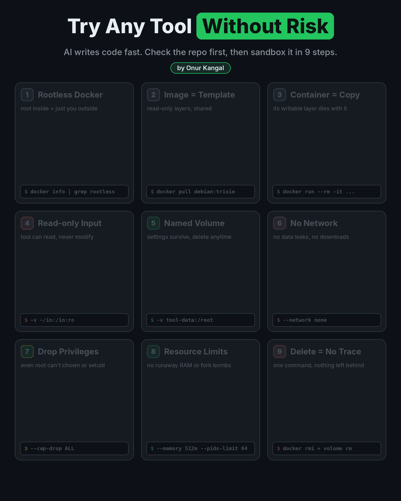
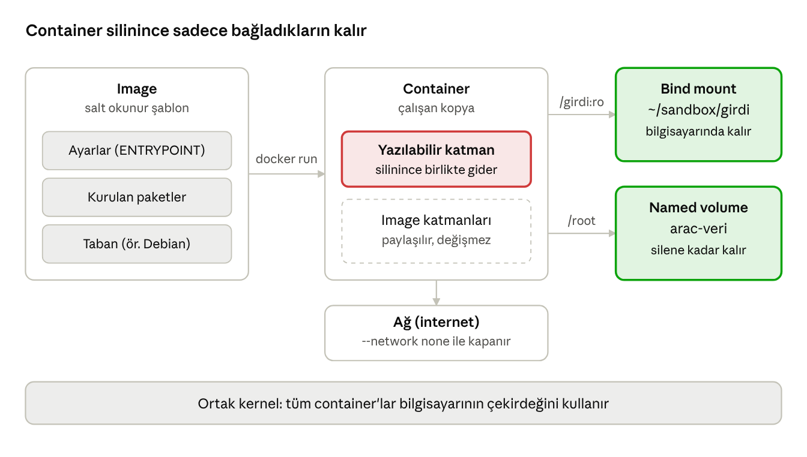

# AI Çağında Açık Kaynak Bir Aracı Güvenle Denemek: İncele, İzole Et, Sil

[English](README.md) | **Türkçe**

<p align="center">
  
</p>

**Yazar:** Onur Kangal · **Son güncelleme:** 10 Kasım 2026 · **Lisans:** [CC BY 4.0](LICENSE) · **Hikâyesi [LinkedIn'de](https://www.linkedin.com/pulse/open-source-isnt-trust-signal-anymore-how-i-try-new-tools-onur-kangal-vldlf)** (İngilizce)

## İçindekiler

- [1. Giriş: "Açık kaynak" artık tek başına güven sebebi değil](#1-giriş-açık-kaynak-artık-tek-başına-güven-sebebi-değil)
- [Önce incele: 5 dakikalık repo kontrolü](#önce-incele-5-dakikalık-repo-kontrolü)
- [Başlamadan önce: İşletim sistemine göre hazırlık](#başlamadan-önce-i̇şletim-sistemine-göre-hazırlık)
- [2. Temel kavramlar: Kafanda canlandır](#2-temel-kavramlar-kafanda-canlandır)
- [3. Rootless Docker nedir, neden önemli?](#3-rootless-docker-nedir-neden-önemli)
- [4. Kurulum ve doğrulama](#4-kurulum-ve-doğrulama)
- [5. İlk container'ın ve yaşam döngüsü](#5-i̇lk-containerın-ve-yaşam-döngüsü)
- [6. Image'lar: Şablonları tanımak](#6-imagelar-şablonları-tanımak)
- [7. Dosya paylaşımı: Bind mount ve volume](#7-dosya-paylaşımı-bind-mount-ve-volume)
- [8. Ağı kapatmak ve güvenlik bayrakları](#8-ağı-kapatmak-ve-güvenlik-bayrakları)
- [9. Uygulama: Bir aracı güvenle kurup çalıştırmak](#9-uygulama-bir-aracı-güvenle-kurup-çalıştırmak)
- [10. Dockerfile ve multi-stage build](#10-dockerfile-ve-multi-stage-build)
- [Çözümlü örnek: ncdu ile baştan sona](#çözümlü-örnek-ncdu-ile-baştan-sona)
- [11. Temizlik ve disk yönetimi](#11-temizlik-ve-disk-yönetimi)
- [12. Sınırlar: Container ne zaman yetmez?](#12-sınırlar-container-ne-zaman-yetmez)
- [13. Sorun giderme](#13-sorun-giderme)
- [14. Hızlı başvuru kartı](#14-hızlı-başvuru-kartı)


## 1. Giriş: "Açık kaynak" artık tek başına güven sebebi değil

AI kod araçlarıyla birlikte yazılım üretmek hem çok hızlandı hem de çok kolaylaştı. Bir kişi birkaç günde tam çalışan bir uygulama yazıp GitHub'a koyabiliyor ve her gün binlerce yeni repo açılıyor. Bunun iyi bir tarafı var: denemeye değer çok sayıda yeni araç. Kötü bir tarafı da var: **"açık kaynak, demek ki birileri incelemiştir" varsayımı yeni repolarda artık geçerli değil.** Kötü niyetli birinin zararlı kodu bu kalabalığın içine saklaması hiç bu kadar kolay olmamıştı.

Bu rehber bu soruna iki katmanlı bir cevap veriyor:

1. **İncele:** Bir aracı çalıştırmadan önce 5 dakikalık bir kontrolle bariz tehlike işaretlerini yakala ("Önce incele" bölümü).
2. **İzole et ve sil:** Aracı kendi sistemine dokunmadan, tek kullanımlık ve kilitli bir container içinde dene; işin bitince tek komutla sil (Bölüm 2–14).

İnceleme tüm kötü niyetli kodu yakalayamaz; container da aracın güvenli olup olmadığını söylemez, sadece verebileceği zararı sınırlar. İkisi birlikte, "bakalım ne olacak" diye bir şeyi doğrudan bilgisayarında çalıştırmaktan çok daha güvenlidir.

Bu rehber şu durumlar için yazıldı:

- GitHub'da çok yeni ama etkileyici bir repo buldun ve güvenli olup olmadığından emin değilsin.
- Bir aracı denemek istiyorsun ama sistemine paket kurmak, `~/.config` gibi klasörlere dosya bırakmasını istemiyorsun.
- "Bu program nereye ne yazdı, nasıl tamamen silerim?" sorusuyla hiç uğraşmamak istiyorsun.

### Bu rehber kimin için?

Terminal kullanmayı bilen ama Docker'ı ya hiç kullanmamış ya da unutmuş herkes için. Her kavram önce **günlük hayattan bir benzetmeyle**, sonra **komutla**, en son da **kendin deneyebileceğin küçük bir deneyle** anlatılıyor.

### Nasıl okunmalı?

1. Bölümleri sırayla oku; her bölüm bir öncekinin üzerine kurulu.
2. Komutları kopyalayıp kendi terminalinde çalıştır. Okumakla değil, denemekle öğrenilir.
3. Her deneyin sonunda "**Beklenen sonuç**" kısmına bak. Gördüğün sonuç farklıysa Bölüm 13'teki sorun giderme tablosuna göz at.
4. Öğrendikten sonra Bölüm 14'teki hızlı başvuru kartını referans olarak kullan.

### Gereken ön bilgi

- Linux terminalinde dolaşmak (`cd`, `ls`, `mkdir`, `cat`).
- Bir komutun çıktısını okuyabilmek.

Rehber Linux, macOS ve Windows'ta kullanılabilir; platformuna göre yapman gereken hazırlık "Başlamadan önce" bölümünde. SELinux ile ilgili notlar Fedora ve RHEL gibi dağıtımlar için geçerli; Ubuntu ve Debian'da bu adımları atlayabilirsin.

> **Önemli:** Container güçlü bir izolasyon sağlar ama mutlak değildir. Gerçekten kötü niyetli olduğundan şüphelendiğin kodlar için Bölüm 12'yi oku.

## Önce incele: 5 dakikalık repo kontrolü

Container, bir aracın güvenli olup olmadığını söylemez; sadece kötü niyetliyse verebileceği zararı sınırlar. Bu yüzden ilk adım her zaman kısa bir incelemedir. Amaç kodun tamamını okumak değil, **bariz tehlike işaretlerini** birkaç dakikada yakalamak.

### Neden artık daha önemli?

- **Yenilik ve kalite artık güven göstergesi değil.** AI araçlarıyla düzgün yazılmış, testleri ve belgeleri olan bir uygulama günler içinde çıkabiliyor. "Bu kadar düzgün bir şeyi kötü niyetli biri yazmaz" diye düşünmek artık yanlış.
- **Popülerlik sahte olabilir.** Yıldız ve fork sayıları şişirilebilir; tek başlarına bir şey kanıtlamazlar.
- **İsim benzerliği bir tuzaktır.** Saldırganlar popüler araçların adına çok benzeyen paketler ve repolar yayınlar (typosquatting).
- **Kimse okumuyor.** Kod miktarı arttıkça, yeni bir repoyu sizden önce birinin incelemiş olma ihtimali azalıyor.

### Kontrol listesi

| # | Neye bakılır | Nerede | Kırmızı bayrak |
| --- | --- | --- | --- |
| 1 | Repo ve hesap geçmişi | Commit geçmişi, ilk commit tarihi, hesabın yaşı ve diğer projeleri, katkı verenler | Hesap çok yeni ve tek repolu; tüm kod tek bir dev commit'te geldi; yıldız sayısı repo yaşına göre olağandışı |
| 2 | Kurulum talimatı | README | `curl ... \| sh`, `sudo` ile kurulum, içeriği gösterilmeyen bir script |
| 3 | Kurulum sırasında çalışan kod | `package.json` içindeki `preinstall`/`postinstall`, `setup.py`, `build.rs`, `Makefile`, `install.sh` | Bu dosyalarda ağ isteği, başka bir yerden binary indirme, base64 ya da okunamaz (obfuscate) kod |
| 4 | Ağ erişimi | Kodda HTTP istemcileri ve URL'ler | Aracın işleviyle ilgisi olmayan sunuculara istek, gizli telemetri |
| 5 | Dosya erişimi | Kodda ev klasörü yolları | `~/.ssh`, `~/.aws`, `.env`, tarayıcı profilleri, kripto cüzdanları gibi işleviyle ilgisiz hassas yerler |
| 6 | Bağımlılıklar | Lockfile (`package-lock.json`, `Cargo.lock`, `poetry.lock`...) ve bağımlılık listesi | Lockfile yok; popüler bir pakete çok benzeyen isim; yeni ve tek kişinin yönettiği bir paket |
| 7 | Hazır binary | Releases sayfası ve CI dosyaları (`.github/workflows`) | Binary'nin kaynak koddan nasıl üretildiği belli değil; CI dışında elle yüklenmiş |

Bir kırmızı bayrak tek başına "zararlı" demek değildir; örneğin bir yedekleme aracının ev klasörünü okuması normaldir. Soru her zaman şu: **bu erişim, aracın yaptığı işle uyumlu mu?**

### Kendin nasıl bakarsın?

Repoyu bir inceleme klasörüne klonla. **Klonlamak kodu çalıştırmaz**; ama klasörü bazı editörlerde açmak otomatik görevleri tetikleyebilir. VS Code soruyorsa klasörü **Restricted Mode**'da aç.

```bash
mkdir -p ~/sandbox/inceleme && cd ~/sandbox/inceleme
git clone <repo-adresi> arac && cd arac

# 1) Geçmiş: ilk commit'ler ve kimler katkı vermiş
git log --reverse --format='%h %an %ad %s' --date=short | head -5
git shortlog -sne

# 3) Kurulumda çalışan kod (hangisi varsa)
grep -n -A8 '"scripts"' package.json
ls setup.py build.rs Makefile install.sh 2>/dev/null

# 4-5) Ağ, komut çalıştırma ve hassas dosya erişimi
grep -rnE 'curl|wget|base64|eval\(|child_process|subprocess|os\.system' --exclude-dir=.git .
grep -rnE '\.ssh|\.aws|\.env|id_rsa|wallet|Cookies' --exclude-dir=.git .
```

Bu `grep` komutları çok sayıda zararsız sonuç da bulur. Bir karar vermezler, sadece **nereye bakman gerektiğini** gösterirler. Bulunan her satırı açıp ne yaptığına bak.

### Yardımcı araçlar

| Araç | Ne yapar | Neyi yakalamaz |
| --- | --- | --- |
| **OpenSSF Scorecard** | Bir repoyu güvenlik pratiklerine göre puanlar: kod incelemesi, CI, imzalı sürümler, bağımlılık güncellemeleri | Kodun kendisinin zararlı olup olmadığını |
| `npm audit`, `pip-audit`, `cargo audit` | Bağımlılıklarda **bilinen** güvenlik açıklarını bulur | Yeni ya da kasıtlı olarak gizlenmiş zararlı kodu |
| Bir AI asistanı | Repoyu senin yerine okuyup yukarıdaki listeye göre özetler; büyük repolarda çok zaman kazandırır | Ustaca gizlenmiş kodu kaçırabilir. Bir AI ajanına kodu **kendi bilgisayarında çalıştırtma**; sadece okumasını iste |

### Karar

| İncelemenin sonucu | Ne yapmalı |
| --- | --- |
| Kırmızı bayrak yok | Rehberdeki sandbox kalıbıyla dene (Bölüm 9) |
| Emin değilsin ya da incelemeye vaktin yok | Dene ama en sıkı ayarlarla: ağ kapalı, yetkiler kaldırılmış, girdi `:ro`, hiçbir gizli bilgi yok |
| Açık kırmızı bayrak (okunamaz kod, hassas dosyalara erişim, şüpheli kurulum script'i) | Deneme. Gerçekten gerekiyorsa sadece sanal makinede (Bölüm 12) |

**Pratik ipucu:** Aynı işi yapan, yıllardır kullanılan ve dağıtımının resmi deposunda (örneğin `apt`, `dnf`) bulunan bir alternatif var mı? Varsa çoğu zaman en güvenli seçim odur.

## Başlamadan önce: İşletim sistemine göre hazırlık

Bu rehber **Linux, macOS ve Windows'ta** kullanılabilir. Container'lar her zaman bir Linux kernel'i üzerinde çalışır: Linux'ta doğrudan senin kernel'inde, macOS ve Windows'ta ise arka planda çalışan küçük bir Linux sanal makinesinde. Komutların neredeyse hepsi üç platformda aynıdır; farklı olan birkaç nokta aşağıda.

### Platformuna göre ne kurmalısın?

| Platform | Kurulacak araç | Container'lar nerede çalışır | Ücretsiz alternatif |
| --- | --- | --- | --- |
| **Linux** | Docker Engine, **rootless** modda (Bölüm 4) | Doğrudan bilgisayarının kernel'inde | Podman (varsayılan olarak rootless) |
| **macOS** | Docker Desktop | Docker Desktop'ın arka planda çalıştırdığı Linux sanal makinesinde | Podman Desktop, Colima |
| **Windows** | Docker Desktop + WSL 2 | WSL 2'deki Linux sanal makinesinde | Podman Desktop |

### Linux

1. Bölüm 4'teki adımlarla Docker'ı **rootless** modda kur ve doğrula.
2. Fedora, RHEL gibi SELinux kullanan bir dağıtımdaysan bind mount'larda `:Z` etiketine dikkat et (Bölüm 7). Ubuntu ve Debian'da gerekmez.

### macOS

1. Docker'ın resmi sitesinden **Docker Desktop**'ı indir. Mac'inin işlemcisine uygun sürümü seç: Apple Silicon (M serisi) ya da Intel.
2. Uygulamayı aç ve üst menü çubuğundaki balina simgesinin "running" durumuna geçmesini bekle.
3. Terminal'i aç ve kurulumu doğrula:

   ```bash
   docker version
   docker run --rm hello-world
   ```
4. Rehberi okurken şunlara dikkat et:
   - **Bölüm 4'ü atla.** Rootless kurulum Linux'a özgü; Docker Desktop'ta daemon zaten sanal makinenin içinde çalışır.
   - **`:Z` ve `:z` etiketleri gerekmez,** çünkü macOS'ta SELinux yok. Komutlarda görürsen silebilirsin.
   - Ev klasörün `/home/...` değil `/Users/<adın>` altındadır; `~` ikisinde de doğru yeri gösterir.
   - Bind mount ile bağlayacağın klasörün Docker Desktop ayarlarındaki paylaşılan klasörler (File sharing) listesinde olması gerekir. `/Users` varsayılan olarak listededir.
   - Apple Silicon Mac'ler ARM işlemcilidir. Sadece Intel (amd64) için yayınlanmış bir image `exec format error` verirse `--platform linux/amd64` ekle; çalışır ama emülasyon nedeniyle yavaştır.

### Windows

1. **WSL 2'yi kur.** PowerShell'i yönetici olarak aç ve çalıştır: `wsl --install`. Bu komut varsayılan olarak Ubuntu'yu da kurar. Bilgisayarı yeniden başlat ve Ubuntu'yu ilk açtığında bir kullanıcı adı ve şifre oluştur.
2. Docker'ın resmi sitesinden **Docker Desktop**'ı kur. Ayarlarda "Use the WSL 2 based engine" seçeneğinin açık olduğunu ve **Resources → WSL Integration** kısmında Ubuntu'nun etkin olduğunu kontrol et.
3. **Komutları Ubuntu (WSL) terminalinde çalıştır.** Başlat menüsünden "Ubuntu" uygulamasını aç. Bu terminalde rehberdeki bütün komutlar (`~`, satır sonundaki `\`, `mkdir -p`) Linux'taki gibi aynen çalışır.
4. Kurulumu doğrula: `docker version` ve `docker run --rm hello-world`.
5. Rehberi okurken şunlara dikkat et:
   - **Bölüm 4'ü atla** ve **`:Z` / `:z` etiketlerini kullanma** (macOS'taki gibi).
   - Deneme klasörlerini (`~/sandbox`) **WSL'in içinde** tut, `/mnt/c/...` altında değil. Hem çok daha hızlı çalışır hem de Windows dosyalarını container'lardan uzak tutar.
   - WSL'deki dosyalarına Windows Gezgini'nden `\\wsl$\Ubuntu\home\<adın>` adresiyle ulaşabilirsin.

Komutları WSL yerine **PowerShell**'de çalıştırmak istersen üç fark var:

| Bash (bu rehber) | PowerShell |
| --- | --- |
| Satır sonunda `\` ile devam | Satır sonunda `` ` `` (backtick) ile devam |
| `-v ~/sandbox/girdi:/girdi:ro` | `-v ${HOME}/sandbox/girdi:/girdi:ro` |
| `mkdir -p ~/sandbox/girdi` | `mkdir ~/sandbox/girdi` |

### Docker Desktop'ta güvenlik nasıl?

macOS ve Windows'ta container'lar zaten bir sanal makinenin içinde çalıştığı için, container'dan kaçan bir program önce o sanal makinede kalır. Bu, Bölüm 3'teki rootless korumasının yerini tutan bir duvardır. Ama sanal makine bilgisayarındaki **paylaşılan klasörlere** erişebilir. Bu yüzden Bölüm 7 ve 8'deki kurallar (dar bind mount'lar, `:ro`, ağı kapatmak, yetkileri kaldırmak) üç platformda da aynı önemdedir.

### Platformlara göre farklar

| Konu | Linux | macOS | Windows (WSL 2) |
| --- | --- | --- | --- |
| Bölüm 4 (rootless kurulum ve kontrol) | Gerekli | Atla | Atla |
| `:Z` / `:z` etiketi (Bölüm 7) | Sadece SELinux varsa | Gereksiz | Gereksiz |
| Komutları nerede çalıştırmalı | Terminal | Terminal | Ubuntu (WSL) terminali |
| Ev klasörü (`~`) | `/home/<adın>` | `/Users/<adın>` | WSL içinde `/home/<adın>` |
| Kaynak sınırları (Bölüm 8c) | cgroup delegasyonu gerekebilir | Docker Desktop ayarlarındaki sanal makine sınırlarının içinde çalışır | macOS ile aynı |
| Image ve container verileri | `~/.local/share/docker` | Docker Desktop'ın sanal makine diski | Docker Desktop'ın sanal makine diski |
| Grafik arayüz | Pods, Podman Desktop | Docker Desktop | Docker Desktop |

### Lisans notu

Linux'taki Docker Engine açık kaynaktır ve ücretsizdir. **Docker Desktop ise kişisel kullanım, eğitim, ticari olmayan açık kaynak projeler ve küçük işletmeler (250'den az çalışan VE 10 milyon dolardan az yıllık gelir) için ücretsizdir;** bu sınırların üstündeki şirketlerde ticari kullanım için ücretli abonelik gerekir ([Docker Desktop lisans sözleşmesi](https://docs.docker.com/subscription/desktop-license/)). İş bilgisayarında kullanacaksan önce şirketinin lisansı olup olmadığını kontrol et ya da ücretsiz alternatiflerden (Podman Desktop, Colima) birini kullan.

## 2. Temel kavramlar: Kafanda canlandır

Docker'da altı kavramı anladığında geri kalan her şey bunların birleşiminden ibaret: **image, container, katman, bind mount, volume ve ağ.**

### Bir mutfak benzetmesi

| Kavram | Benzetme | Gerçekte ne? |
| --- | --- | --- |
| **Image** | Yemek tarifi | Küçük bir Linux'un salt okunur dosya sistemi (`/bin`, `/etc`, kütüphaneler) ve "açılınca ne çalışsın" gibi birkaç ayar |
| **Container** | Tariften pişen tabak | Image'dan açılmış, çalışan bir kopya. Üstüne yazılabilir ince bir katmanı var |
| **Katman (layer)** | Tarifin adımları | Image'ı oluşturan üst üste dosya paketleri. Ortak katmanlar diskte bir kez durur |
| **Bind mount** | Mutfağa kendi tencereni getirmek | Bilgisayarındaki gerçek bir klasörü container'ın içinde görünür yapmak |
| **Volume** | Restoranın kilerdeki saklama kabı | Docker'ın kendi yönettiği, container silinse de kalan depolama alanı |
| **Ağ (network)** | Mutfağın dışarı açılan kapısı | Container'ın internete ya da diğer container'lara erişimi. Kapıyı tamamen kapatabilirsin |

### En önemli fikir

Container'ın içine yazılan her şey, o container'a ait yazılabilir katmanda durur. Container'ı sildiğinde **o katman da silinir.** Geriye sadece şu ikisi kalır:

- **Bind mount ile bağladığın klasörler**, çünkü onlar zaten senin bilgisayarında.
- **Volume'ler**, çünkü onları sen ayrıca silene kadar Docker saklar.

Yani "temizlik" sorusunun cevabı çok basit: neyi bağladığını sen seçersin, geri kalan her şey container'la birlikte gider.



Kırmızı katman container ile birlikte silinir; yeşil kutular sen silene kadar kalır. Tüm container'lar aynı kernel'i paylaşır.

### Container sanal makine değil

Image'ın içinde **kernel (çekirdek) yok.** Container, senin bilgisayarının kernel'ini kullanır ve sadece ondan "yalıtılmış bir oda" ister. Bu yüzden:

- Sanal makineye göre çok daha hızlı açılır, genelde bir saniyenin altında.
- Çok daha az bellek ve disk harcar.
- Ama izolasyonu sanal makine kadar güçlü değildir, çünkü kernel ortaktır (Bölüm 12).

## 3. Rootless Docker nedir, neden önemli?

Rootless Docker'da Docker'ın arka plan servisi (daemon) **root olarak değil, senin kullanıcın olarak** çalışır. Bu yüzden container'dan bir kaçış olsa bile kaçan program sisteme root olarak değil, en fazla senin yetkinle erişebilir.

### Normal (rootful) Docker'ın gizli tehlikesi

Klasik Docker kurulumunda daemon root olarak çalışır. Kullanıcını `docker` grubuna eklediğinde, **fiilen o kullanıcıya root yetkisi vermiş olursun.** Örneğin şu komut, tüm sistem dosyalarını container'ın içine bağlar ve onları root olarak düzenlemeye izin verir:

```bash
docker run -v /:/host debian bash   # rootful'da: tüm sistem elinde
```

Aynı komut rootless Docker'da sadece senin zaten erişebildiğin dosyaları gösterir.

### Perde arkasında ne oluyor? (User namespace)

Linux'ta her kullanıcının bir numarası (UID) vardır. Root'un UID'i 0, senin UID'in genelde 1000'dir. Rootless Docker, container'ın içindeki UID'leri dışarıdaki başka UID'lere **eşler** (map eder):

| Container'ın içinde | Bilgisayarında (host) | Anlamı |
| --- | --- | --- |
| `root` (UID 0) | **Sen** (UID 1000) | İçeride her şeye gücü yeten root, dışarıda sıradan bir kullanıcı |
| UID 1 – 65535 | Sana ayrılmış bir aralık (ör. 524288–589823) | Host'ta bu UID'lere ait hiçbir dosya yok, yani hiçbir şeye erişemezler |
| `--privileged` ile root | Yine sadece sen | Rootful'daki kadar tehlikeli değil ama yine de kullanma |

Sana ayrılan aralık `/etc/subuid` ve `/etc/subgid` dosyalarında yazar:

```bash
grep $USER /etc/subuid
# örnek çıktı: onur:524288:65536
```

**Benzetme:** Container bir oyun gibi. Oyunun içinde kral olabilirsin (root), ama oyundan çıkıp gerçek dünyaya bir şey yapmaya çalıştığında sadece sıradan bir oyuncusun (UID 1000).

### Rootless'ta nereler farklı?

| Konu | Rootful Docker | Rootless Docker |
| --- | --- | --- |
| Daemon kimin yetkisiyle çalışır | root | Senin kullanıcın |
| Soket (iletişim dosyası) | `/var/run/docker.sock` | `/run/user/1000/docker.sock` |
| Image ve container'lar nerede | `/var/lib/docker` | `~/.local/share/docker` |
| Servis | Sistem servisi (`systemctl`) | Kullanıcı servisi (`systemctl --user`) |
| Container'dan kaçış olursa | Sistem root'u ele geçer | En fazla senin yetkin |
| 1024 altı portlar (80, 443) | Kullanılabilir | Varsayılan olarak kullanılamaz, 8080 gibi yüksek port kullanılır |
| Ağ performansı | Daha hızlı | Biraz daha yavaş (kullanıcı alanında çalışan bir katmandan geçer) |

**Sonuç:** Bir şeyleri güvenle denemek için rootless Docker çok daha uygun. Kaybedilen birkaç özellik bu iş için neredeyse hiç önemli değil.

> **Alternatif:** Podman, varsayılan olarak rootless çalışan ve komutları Docker'la neredeyse aynı olan bir araçtır. Bu rehberdeki komutların çoğu `docker` yerine `podman` yazarak da çalışır.

## 4. Kurulum ve doğrulama

Bu bölümün amacı, Docker'ın gerçekten **rootless** modda çalıştığından emin olmak. Kurulum dağıtıma göre değiştiği için burada sadece genel akış var; ayrıntılar için Docker'ın resmi "Rootless mode" belgesine bak.

> **macOS ve Windows kullanıcıları:** Bu bölüm Linux'a özgü. Docker Desktop kullanıyorsan "Başlamadan önce" bölümündeki doğrulamayı yaptıysan doğrudan Bölüm 5'e geçebilirsin.

### Kurulum ana hatlarıyla

1. Docker Engine'i ve `docker-ce-rootless-extras` paketini dağıtımının paket yöneticisiyle kur.
2. Rootful daemon çalışıyorsa durdur: `sudo systemctl disable --now docker.service docker.socket`
3. Kendi kullanıcınla (sudo olmadan) kurulum script'ini çalıştır: `dockerd-rootless-setuptool.sh install`
4. Script'in sonunda yazdığı `export DOCKER_HOST=...` satırını not al (aşağıdaki uyarıya bak).

### Adım 4a: Rootless mı çalışıyor?

```bash
docker info | grep -i rootless
```

**Beklenen sonuç:** Çıktıda `rootless` kelimesi geçmeli (genelde `Security Options` altında). Boş çıkarsa rootful Docker'a bağlanıyorsun demektir.

### Adım 4b: Daemon çalışıyor mu?

```bash
systemctl --user status docker
```

**Beklenen sonuç:** `active (running)`. Dikkat: komutta `--user` var, çünkü bu bir **kullanıcı servisi**.

### Adım 4c: Context'ler ve `DOCKER_HOST` uyarısı

**Context**, Docker komut satırının hangi daemon'a bağlanacağını söyleyen kayıtlı bir ayardır. Listelemek için:

```bash
docker context ls
```

Şöyle bir çıktı görebilirsin:

```
NAME        DESCRIPTION                               DOCKER ENDPOINT
default *   Current DOCKER_HOST based configuration   unix:///run/user/1000/docker.sock
rootless    Rootless mode                             unix:///run/user/1000/docker.sock
Warning: DOCKER_HOST environment variable overrides the active context.
```

**Bu çıktıyı nasıl okumalı?**

- İki context da aynı adresi gösteriyor: `/run/user/1000/docker.sock`. Buradaki `1000` senin kullanıcı numaran. Yani ikisi de rootless daemon'a gidiyor.
- Uyarının anlamı: "`DOCKER_HOST` diye bir ortam değişkeni tanımlı, o yüzden context seçimini dikkate almıyorum." `DOCKER_HOST` da zaten rootless sokete işaret ettiği için **sonuç aynı, sorun yok.**

Uyarıyı kaldırmak istersen:

```bash
unset DOCKER_HOST
docker context use rootless
```

Kalıcı olması için `~/.bashrc` dosyasındaki `export DOCKER_HOST=...` satırını sil ya da başına `#` koy.

### Adım 4d (isteğe bağlı): Oturum kapanınca da çalışsın

Kullanıcı servisleri normalde oturumu kapatınca durur. Uzun süre çalışan container'ların varsa:

```bash
loginctl enable-linger $USER
```

### Görsel aracı tercih edersen

Linux'ta **Pods** (Flathub'da) gibi grafik arayüzler de aynı rootless sokete bağlanır. Image'ları, container'ları ve volume'leri listelemek, logları okumak, silmek ve container başlatıp durdurmak için rahattır. Ama yeni bir container'ı güvenlik ayarlarıyla açmak için terminal daha nettir, çünkü hangi ayarı verdiğini birebir görürsün.

## 5. İlk container'ın ve yaşam döngüsü

İlk container'ını tek bir komutla açıp, içine girip, çıktığında otomatik silinmesini sağlayabilirsin.

### Deney 5a: İçeri gir, etrafa bak, çık

```bash
docker run --rm -it debian:trixie bash
```

Komutun her parçası:

| Parça | Anlamı |
| --- | --- |
| `docker run` | Yeni bir container başlat |
| `--rm` | Container'dan çıkınca onu otomatik sil |
| `-it` | Terminal aç ve yazdıklarını container'a ilet (`-i` girdi, `-t` terminal) |
| `debian:trixie` | Kullanılacak image (şablon). Bilgisayarda yoksa önce indirilir |
| `bash` | Container açılınca çalışacak komut |

İlk çalıştırmada şöyle satırlar görürsün:

```
Unable to find image 'debian:trixie' locally
trixie: Pulling from library/debian
...: Download complete
Digest: sha256:...
Status: Downloaded newer image for debian:trixie
root@9d2bca799f46:/#
```

Son satırdaki `root@9d2bca799f46` artık container'ın içinde olduğunu gösteriyor. `9d2bca799f46` container'ın kimliği (ID). İçeride şunları dene:

```bash
whoami          # root
cat /etc/os-release | head -2   # Debian olduğunu görürsün
ls /home        # boş: senin ev klasörün burada yok
exit
```

**Beklenen sonuç:** `whoami` sana `root` der. Ama Bölüm 3'te gördüğün gibi bu sadece **container'ın içinde** böyle; dışarıda hala sen sıradan kullanıcısın. `ls /home` boş çıkar, çünkü senin dosyaların container'a hiç verilmedi.

### Deney 5b: Tek bir komut çalıştırıp çık

Her zaman `bash` açmak zorunda değilsin. Sadece bir komut çalıştırıp sonucunu almak için `-it` olmadan:

```bash
docker run --rm debian:trixie cat /etc/debian_version
```

### Deney 5c: Kalıcı bir container ve `docker diff`

`--rm` yazmazsan container çıktığında silinmez, "durmuş" olarak bekler. Bu sayede ona tekrar girebilirsin.

```bash
docker run -it --name kutu debian:trixie bash
# içeride:
echo "merhaba" > /root/not.txt
exit

docker ps -a                 # 'kutu' listede, durumu: Exited
docker diff kutu             # içeride hangi dosyalar değişti?
docker start -ai kutu        # tekrar gir; /root/not.txt hala orada
exit
docker rm kutu               # tamamen sil
```

**Beklenen sonuç:** `docker diff`, container'ın image'a göre neleri değiştirdiğini listeler: `A` eklendi, `C` değişti, `D` silindi. Örneğin `A /root/not.txt`. İzolasyonun en güzel kanıtı bu: değişen her şey container'ın kendi katmanında.

> **İpucu:** Şüphelendiğin bir aracı kurduktan sonra `docker diff` ile sistemde nereye ne yazdığını görebilirsin. Normal bir sistemde bunu bulmak saatler sürebilir.

### Yaşam döngüsü komutları

| İş | Komut |
| --- | --- |
| Tek kullanımlık çalıştır, çıkınca silinsin | `docker run --rm -it <image> bash` |
| İsimli oluştur ve içine gir | `docker run -it --name <isim> <image> bash` |
| Durmuş container'a tekrar gir | `docker start -ai <isim>` |
| Çalışan container'da ikinci bir terminal aç | `docker exec -it <isim> bash` |
| Çalışanları listele | `docker ps` |
| Durmuşlar dahil hepsini listele | `docker ps -a` |
| Durdur | `docker stop <isim>` |
| Sil (çalışıyorsa da) | `docker rm -f <isim>` |
| Image'a göre neler değişti? | `docker diff <isim>` |
| Container'dan dosya al | `docker cp <isim>:/yol/dosya ./dosya` |
| Container'ın çıktıları (loglar) | `docker logs <isim>` |

**Not:** `docker run` her seferinde **yeni** bir container oluşturur. Var olan bir container'a dönmek için `docker start` kullanılır. Aynı isimle ikinci bir `docker run` yaparsan "name already in use" hatası alırsın.

## 6. Image'lar: Şablonları tanımak

Image, container'ın **hazır şablonudur.** Ne kadar iyi tanırsan, neyi çalıştırdığını o kadar iyi bilirsin.

### İsmin anatomisi

`debian:trixie` aslında kısaltılmış bir isim. Tam hali:

```
docker.io  /  library  /  debian  :  trixie
kayıt yeri     sahibi      adı      etiket (tag)
```

| Parça | Anlamı | Örnekler |
| --- | --- | --- |
| Kayıt yeri (registry) | Image'ın indirildiği sunucu. Yazmazsan Docker Hub (`docker.io`) | `docker.io`, `ghcr.io` (GitHub), `quay.io` |
| Sahibi | Image'ı yükleyen hesap. `library` = resmi image'lar | `library`, `bitnami`, bir kişinin kullanıcı adı |
| Adı | Image'ın adı | `debian`, `python`, `nginx` |
| Etiket (tag) | Sürüm. Yazmazsan `latest` kullanılır | `trixie`, `3.13-slim`, `1.7.12` |

Örnek okumalar:

- `nginx:latest` → Docker Hub, resmi, nginx, en son sürüm.
- `ghcr.io/kullanici/arac:latest` → GitHub'ın kayıt yeri, kişisel bir hesap.
- `rust:1-bookworm` → Rust 1.x, Debian 12 (bookworm) tabanı üzerinde.

Debian sürümlerinin kod adları vardır: **bookworm = Debian 12**, **trixie = Debian 13**. Bu rehberin yazıldığı tarihte `debian:latest` = trixie.

### Katmanlar

Image'lar üst üste binen katmanlardan oluşur. Örneğin `python:3.13` kabaca: Debian tabanı + derleme araçları + Python. İki farklı image aynı Debian tabanını kullanıyorsa o katman diskte **bir kez** durur. Image indirirken gördüğün şu satırlar bunu anlatır:

```
69245854ad58: Already exists      ← bu katman zaten diskte vardı
2a19ddfe5595: Download complete   ← bu katman indirildi
```

Katmanları görmek için: `docker history debian:trixie`

### Etiket ve digest: değişen ve değişmeyen

- **Etiket** (`trixie`, `latest`) bir yer imi gibidir; zamanla yeni güncellemelere kayar. Bugün `debian:trixie` ile bir ay sonraki aynı şey olmayabilir.
- **Digest** (`sha256:268f...`) image'ın parmak izidir. İçerik bir bit bile değişirse digest de değişir.

Tam olarak aynı içeriği istiyorsan digest'le çek: `docker pull debian@sha256:268f...`. Listede etiket yerine uzun bir `@sha256:` görürsen o image digest'le indirilmiş demektir.

### Hangi image'a güvenebilirsin?

Bir image'ın içindeki her şey, onu yükleyen hesaba duyduğun güvene bağlıdır. Docker Hub'da image sayfasında şu rozetlere bak:

| Tür | Rozet | Güven |
| --- | --- | --- |
| Resmi (`debian`, `python`, `node`, `nginx`) | **Docker Official Image** | Yüksek |
| Doğrulanmış şirket | **Verified Publisher** | Yüksek |
| Kişisel hesap (`birisi/arac`) | Rozet yok | Bilinmez. Kod gibi incelenmesi gerekir |

**Pratik kural:** Taban olarak resmi bir image kullan, deneyeceğin aracı içine **kendin** kur. Kişisel bir hesabın hazır image'ını doğrudan çalıştırmak, o kişinin yüklediği her şeyi çalıştırmak demektir.

### Sık kullanılan taban image'lar

| Image | Yaklaşık boyut | Ne zaman |
| --- | --- | --- |
| `debian:trixie` | 50 MB indirme | Genel deneme, `apt` ile paket kurma |
| `debian:trixie-slim` | Daha küçük | Aynı ama gereksiz dosyalar atılmış; çalıştırma image'ları için ideal |
| `ubuntu:24.04` | 30 MB indirme | Ubuntu'ya alışıksan |
| `alpine` | 4 MB | Çok küçük ama `glibc` yerine `musl` kullanır; bazı programlar çalışmayabilir |
| `fedora` | 60 MB indirme | Fedora kullanıyorsan ve aynı ortamı istiyorsan |
| `python`, `node`, `rust`, `golang` | Büyük (1 GB ve üzeri olabilir) | Dilin araçları hazır gelsin istiyorsan |

### Image komutları

| İş | Komut |
| --- | --- |
| İndirilmiş image'ları listele | `docker images` |
| Sadece indir, çalıştırma | `docker pull <image>` |
| Katmanlarını gör | `docker history <image>` |
| Tüm ayrıntıları gör (JSON) | `docker image inspect <image>` |
| Sil | `docker rmi <image>` |

### `docker images` çıktısını okumak

- **DISK USAGE:** açılmış halinin diskte kapladığı yer. Ortak katmanlar birden fazla image'da sayıldığı için bu sütunun toplamı gerçek kullanımdan fazla çıkar.
- **CONTENT SIZE:** indirilen sıkıştırılmış boyut.
- **`U` (In Use):** o image'dan oluşturulmuş bir container (çalışıyor ya da durmuş) varsa görünür.
- Gerçek toplam disk kullanımı için: `docker system df` (Bölüm 11).

## 7. Dosya paylaşımı: Bind mount ve volume

Container varsayılan olarak senin dosyalarını hiç görmez. Bir aracı denemek için genelde ona bazı dosyalar vermen (girdi) ve bazı sonuçları geri alman (çıktı) gerekir. Bunun iki yolu var: **bind mount** ve **volume.**

### Bind mount: Bir klasörü içeri bağlamak

Yazım şekli:

```
-v <bilgisayardaki klasör>:<container'daki yol>:<seçenekler>
```

**Benzetme:** Container'ın duvarına bir pencere açıyorsun. Pencereden sadece o klasör görünür; evin geri kalanı görünmez.

#### Deney 7a: Hazırlık

```bash
mkdir -p ~/sandbox/paylasim
echo "dışarıdan yazıldı" > ~/sandbox/paylasim/not.txt
```

#### Deney 7b: Okuma-yazma bağlama

```bash
docker run --rm -it -v ~/sandbox/paylasim:/veri:Z debian:trixie bash
```

İçeride:

```bash
cat /veri/not.txt                         # dışarıdaki dosyayı görüyor musun?
echo "içeriden yazıldı" >> /veri/not.txt   # bağlı klasöre yaz
echo "kaybolacak" > /root/deneme.txt      # bağlı OLMAYAN bir yere yaz
exit
```

Dışarıda kontrol et:

```bash
cat ~/sandbox/paylasim/not.txt
```

**Beklenen sonuç:**

- `not.txt` dosyasında iki satır var. Bağlı klasöre yazılan her şey **gerçekten bilgisayarına yazılır.**
- `/root/deneme.txt` ise yok oldu, çünkü container `--rm` ile silindi ve o dosya container'ın kendi katmanındaydı.

Bu, izolasyonun temel mantığı: **sadece bağladığın klasör dışarıyla paylaşılır, geri kalan her şey container silinince gider.**

#### Deney 7c: Salt okunur bağlama (güvenli olan)

```bash
docker run --rm -it -v ~/sandbox/paylasim:/veri:ro,Z debian:trixie bash
```

İçeride:

```bash
echo "deneme" >> /veri/not.txt      # mevcut dosyayı değiştirmeyi dene
echo "deneme" > /veri/yeni.txt      # yeni dosya oluşturmayı dene
exit
```

**Beklenen sonuç:** İki komut da `Read-only file system` hatası verir. `:ro` ile container dosyaları okuyabilir ama değiştiremez, silemez ve **yeni dosya da oluşturamaz.**

**Pratik sonucu:** Bir aracın girdi dosyalarını `:ro` ile ver. Araç bir şeyler kaydetmek istiyorsa (ayarlar, kayıt dosyaları, çıktılar), bunun için **ayrı bir yazılabilir yer** ver (aşağıdaki volume'e bak).

### SELinux ve `:z` / `:Z` etiketleri (Fedora, RHEL)

SELinux açık olan dağıtımlarda, bağladığın klasör container'ın içinde `Permission denied` verebilir. Sebep dosya izinleri değil, SELinux'un container'a o klasörü kullanma izni vermemesidir. Çözümü mount'a bir etiket eklemek:

| Etiket | Ne yapar | Ne zaman |
| --- | --- | --- |
| `:z` (küçük) | Klasörü birden fazla container'ın paylaşabileceği şekilde etiketler | Aynı klasörü birkaç container kullanacaksa |
| `:Z` (büyük) | Klasörü sadece bu container'a özel etiketler | Tek container kullanacaksa |

> **Uyarı:** Bu etiketler klasörün SELinux etiketini **kalıcı olarak** değiştirir. Bunları asla `$HOME`, `~/.config`, `/usr` ya da `/etc` gibi klasörlere verme; host'taki diğer uygulamalar bozulabilir. Sadece bu iş için açtığın klasörlerde (örneğin `~/sandbox/...`) kullan.

Ubuntu ve Debian'da SELinux yerine AppArmor vardır; orada `:z`/`:Z` gerekmez ama yazman zarar da vermez.

### Named volume: Docker'ın yönettiği depo

Volume, Docker'ın kendi yönettiği bir depolama alanıdır. Bind mount'tan farkı, senin bilgisayarındaki belli bir klasöre bağlı olmamasıdır.

**Benzetme:** Bind mount kendi tenceren, volume ise kiraladığın bir dolap. Dolabın içine sadece Docker üzerinden erişiyorsun ama silmek tek bir komut.

```bash
docker run --rm -it -v arac-veri:/root/.local/state debian:trixie bash
```

- Yazım bind mount'a benziyor, ama sol tarafta bir klasör yolu yerine **bir isim** (`arac-veri`) var.
- Bu isimde bir volume yoksa Docker ilk çalıştırmada onu oluşturur.
- Container `--rm` ile silinse bile volume kalır. Bir sonraki çalıştırmada veriler yerinde olur.
- SELinux etiketi gerekmez.

#### Volume'ün içine bakmak

Volume'ler `~/.local/share/docker` altında tutulduğu için onlara doğrudan bakmak zahmetli. En kolay yol, geçici bir container açıp volume'ü ona bağlamak:

```bash
docker run --rm -v arac-veri:/v debian:trixie ls -R /v
```

#### Volume komutları

| İş | Komut |
| --- | --- |
| Listele | `docker volume ls` |
| Ayrıntılar | `docker volume inspect <isim>` |
| Sil | `docker volume rm <isim>` |
| Hiçbir container'ın kullanmadığı volume'leri sil | `docker volume prune` |

> **Dikkat:** `docker volume prune` başka projelerin verilerini de silebilir (örneğin bir veritabanı volume'ü). Emin değilsen tek tek `docker volume rm <isim>` kullan.

### Hangisini ne zaman?

| Yöntem | Artıları | Eksileri | Ne zaman |
| --- | --- | --- | --- |
| Bind mount, `:ro` | Araç dosyalarını okur ama bozamaz | Araç oraya hiçbir şey yazamaz | Girdi dosyaları (belgeler, veri, oyun dosyaları) |
| Bind mount, yazılabilir | Çıktılar doğrudan bilgisayarında, görebilir ve yedekleyebilirsin | Araç o klasöre istediğini yazabilir; klasörü kendin silmelisin | Aracın ürettiği çıktıları almak istediğinde |
| Named volume | Docker yönetir, `:Z` gerekmez, tek komutla silinir | Dosyaları doğrudan görmek zahmetli | Ayarlar, kayıtlar, önbellek: aracın kendi durumu |
| Hiçbiri | En temiz, hiç iz kalmaz | Container silinince her şey gider | Tek seferlik denemeler |

**Altın kural:** Yazılabilir verdiğin her yere araç dosya bırakabilir. Bu yüzden yazılabilir klasörü **dar** tut: sadece bu iş için açtığın, içinde başka bir şey olmayan bir klasör. Asla `$HOME` gibi geniş bir yeri yazılabilir verme.

## 8. Ağı kapatmak ve güvenlik bayrakları

Varsayılan ayarlar zaten makul bir izolasyon sağlar. Ama şüphelendiğin bir şeyi çalıştırırken birkaç bayrakla kapıları tek tek kapatabilirsin. Her bayrağı önce bayraksız, sonra bayraklı çalıştırıp farkı kendin göreceksin.

### Deney 8a: Ağı kesmek (`--network none`)

```bash
# Ağ açıkken: IP adresleri yazmalı
docker run --rm debian:trixie getent hosts debian.org

# Ağ kapalıyken: hiçbir şey yazmamalı
docker run --rm --network none debian:trixie getent hosts debian.org
echo "çıkış kodu: $?"
```

`getent hosts` bir alan adını IP adresine çevirir (DNS sorgusu).

**Beklenen sonuç:**

- Ağ açıkken `2a04:4e42:...` gibi adresler görürsün. Bunlar **IPv6** adresleri; `getent hosts` varsa önce IPv6'yı gösterir. Alışık olduğun IPv4 adresleri için `getent ahostsv4 debian.org` kullan. Orada her adres 3 kez görünür: `STREAM` (TCP), `DGRAM` (UDP) ve `RAW`; adres aynı, sadece bağlantı türü farklı.
- Ağ kapalıyken çıktı boş, çıkış kodu `2` olur. `0` başarı, `0` dışındaki her değer başarısızlık demek. Yani container dışarıya hiç ulaşamadı.

**Neden önemli?** Ağı olmayan bir program **verini dışarı sızdıramaz** ve **dışarıdan başka zararlı kod indiremez.** Şüpheli bir aracın yapabileceği en tehlikeli iki şey bunlardır.

### Deney 8b: Yetkileri kaldırmak (`--cap-drop ALL`)

Linux'ta root'un gücü tek parça değildir; **capability** denen bir dizi ayrı yetkiye bölünmüştür. Örneğin "dosyanın sahibini değiştirme" (`CAP_CHOWN`) bunlardan biri. Container'daki root varsayılan olarak bu yetkilerin bir kısmına sahiptir.

```bash
# Varsayılan: OK yazmalı
docker run --rm debian:trixie sh -c 'touch /tmp/x && chown nobody /tmp/x && echo OK'

# Yetkiler kaldırılmış: hata vermeli
docker run --rm --cap-drop ALL debian:trixie sh -c 'touch /tmp/x && chown nobody /tmp/x && echo OK'
```

**Beklenen sonuç:** İkinci komut `chown: changing ownership of '/tmp/x': Operation not permitted` hatası verir. Container'daki root bile artık bu işi yapamaz.

**Pratikte dikkat:** `apt-get install` gibi paket kurulumları bazı yetkilere ihtiyaç duyar, bu yüzden `--cap-drop ALL` ile kurulum yapamayabilirsin. Bunun çözümü Bölüm 9'daki kalıp: **önce normal ayarlarla kur, sonra sıkı ayarlarla çalıştır.**

### Deney 8c: Kaynak sınırları

```bash
docker run --rm --memory 256m debian:trixie cat /sys/fs/cgroup/memory.max
```

**Beklenen sonuç:** `268435456`, yani 256 × 1024 × 1024 bayt = 256 MB. Container'ın içinden bakıldığında bellek sınırı gerçekten uygulanmış.

Hata alırsan sebep **cgroup delegasyonu**dur: rootless modda kaynak sınırlarının çalışması için sistemin bu yetkiyi kullanıcıya devretmiş olması gerekir. Kontrol etmek için:

```bash
cat /sys/fs/cgroup/user.slice/user-$(id -u).slice/cgroup.controllers
```

Çıktıda `memory`, `pids` ve `cpu` görüyorsan sınırlar çalışır. Modern Fedora ve Ubuntu sürümlerinde bu genelde açıktır.

### Tüm güvenlik bayrakları

| Bayrak | Ne yapar | Neye karşı korur |
| --- | --- | --- |
| `--network none` | Ağ erişimini tamamen keser | Veri sızdırma, dışarıdan kod indirme |
| `--cap-drop ALL` | Tüm Linux capability'lerini kaldırır | Container içindeki root'un özel yetkileri kullanması |
| `--security-opt no-new-privileges` | setuid programlarla yetki yükseltmeyi engeller | İçeride bir programın sonradan daha fazla yetki kazanması |
| `--memory 2g` | Bellek kullanımını sınırlar | Belleği şişirip bilgisayarı kilitlemesi |
| `--pids-limit 256` | Açılabilecek process sayısını sınırlar | Sonsuz process açması (fork bomb) |
| `--cpus 2` | CPU kullanımını sınırlar | CPU'yu tamamen işgal etmesi |
| `--read-only` | Container'ın kendi dosya sistemini salt okunur yapar | İçeride dosya değiştirmesi |
| `--tmpfs /tmp` | `/tmp`'yi bellekte geçici bir alan yapar | `--read-only` ile birlikte, programın geçici dosya yazabilmesi için |
| `-v klasor:/x:ro` | Bağlanan klasörü salt okunur yapar | Senin dosyalarını değiştirmesi ya da silmesi |

### Hepsi bir arada: "Sıkı mod" şablonu

```bash
docker run --rm -it \
  --network none \
  --cap-drop ALL \
  --security-opt no-new-privileges \
  --memory 2g --pids-limit 256 --cpus 2 \
  -v ~/sandbox/girdi:/girdi:ro,Z \
  debian:trixie bash
```

**Satır sonundaki `\` karakteri** komutun bir sonraki satırda devam ettiğini söyler. Uzun komutları okunur kılmak için kullanılır; `\`'den sonra boşluk olmamalı.

### Asla yapma

| Bayrak | Neden tehlikeli |
| --- | --- |
| `-v $HOME:/...` ya da `-v /:/...` | Container tüm dosyalarına (SSH anahtarları, tarayıcı profilleri, token'lar) erişir |
| `-v /var/run/docker.sock:...` veya `-v $XDG_RUNTIME_DIR/docker.sock:...` | Container Docker'ı kontrol edebilir, yani kendine istediği kadar yetkiyle yeni container açabilir |
| `--privileged` | Tüm güvenlik kontrollerini kapatır |
| `--network host` | Container bilgisayarının ağını doğrudan kullanır |
| `--pid host` | Container bilgisayarındaki tüm process'leri görür |

## 9. Uygulama: Bir aracı güvenle kurup çalıştırmak

Buraya kadar öğrendiğin her şeyi tek bir kalıpta birleştiriyoruz: **ağ açık ve normal yetkilerle kur, kaydet, sonra ağ kapalı ve sıkı ayarlarla çalıştır.** Bu kalıp bir Python script'i, bir Rust aracı, bir Node uygulaması ya da indirilmiş bir binary için aynıdır.

Aşağıda `<arac>` geçen yerlere denemek istediğin aracın adını yaz.

### Adım 1: Klasörleri hazırla

```bash
mkdir -p ~/sandbox/<arac>/girdi
```

Aracın işleyeceği dosyaları (belgeler, veri dosyaları vb.) bu `girdi` klasörüne koy.

### Adım 2: Kurulum container'ı (ağ açık)

Aracın diline uygun resmi bir image seç ve **isimli** bir container aç. `--rm` kullanmıyoruz, çünkü kurduğumuz şeyi saklayacağız.

```bash
docker run -it --name <arac>-kurulum <taban-image> bash
```

> **Dikkat:** Kurulum sırasında ağ açıktır ve paketlerin kurulum script'leri otomatik çalışır. Bu container'a **asla** API anahtarı, token, `.env` dosyası ya da hassas bir klasör verme (Bölüm 12, "Kurulum anı").

İçeride aracı kur. Dile göre örnekler:

| Aracın türü | Taban image | Kurulum komutu (container içinde) |
| --- | --- | --- |
| Python paketi | `python:3.13-slim` | `pip install <paket>==<sürüm>` |
| Python, GitHub'dan | `python:3.13-slim` | `apt-get update && apt-get install -y git && pip install git+https://github.com/<sahip>/<repo>` |
| Node paketi | `node:22-slim` | `npm install -g <paket>@<sürüm>` |
| Rust aracı | `rust:1-trixie` | `cargo install <crate> --locked` |
| Go aracı | `golang:1` | `go install <modül>@<sürüm>` |
| Hazır binary | `debian:trixie` | `apt-get update && apt-get install -y curl && curl -LO <url>` |
| Herhangi bir script | `debian:trixie` | `apt-get install` ile gereken paketler, sonra script'i indir |

Aracın sistem kütüphanelerine ihtiyacı varsa (README'de "dependencies" ya da "requirements" bölümüne bak), önce onları `apt-get install` ile kur.

Kurulumdan sonra kontrol et ve çık:

```bash
which <arac>        # nereye kuruldu?
<arac> --version    # çalışıyor mu?
exit
```

### Adım 3 (isteğe bağlı): Kurulum nereye ne yazdı?

```bash
docker diff <arac>-kurulum | head -50
```

Bu liste, kurulumun container'da değiştirdiği her dosyayı gösterir. Normal bir bilgisayarda "bu program nereye ne bıraktı?" sorusunun cevabını bulmak çok zordur; burada tek komut.

### Adım 4: Kurulumu image olarak kaydet

```bash
docker commit <arac>-kurulum <arac>-sandbox
docker rm <arac>-kurulum
```

- **`docker commit`** container'ın o anki halini yeni bir image olarak kaydeder. Artık `<arac>-sandbox` adında kendi image'ın var.
- Kurulum container'ını sildik, çünkü işi bitti.

> `docker commit` öğrenmek için pratik ama tekrarlanabilir değil: neyi nasıl kurduğunu bir yere yazmaz. Aynı ortamı tekrar tekrar kuruyorsan Bölüm 10'daki Dockerfile yöntemine geç.

### Adım 5: Sıkı ayarlarla çalıştır (ağ kapalı)

```bash
docker run --rm -it \
  --network none \
  --cap-drop ALL \
  --security-opt no-new-privileges \
  --memory 1g --pids-limit 256 \
  -v ~/sandbox/<arac>/girdi:/girdi:ro,Z \
  -v <arac>-veri:/root \
  <arac>-sandbox <arac> /girdi/<dosya>
```

Her satır öğrendiğin bir konuya karşılık geliyor:

| Satır | Ne işe yarıyor | Bölüm |
| --- | --- | --- |
| `--rm -it` | Tek kullanımlık, etkileşimli terminal | 5 |
| `--network none` | Dışarıya bağlanamaz | 8 |
| `--cap-drop ALL`, `no-new-privileges` | Yetkiler kaldırıldı | 8 |
| `--memory`, `--pids-limit` | Kaynaklar sınırlı | 8 |
| `girdi:/girdi:ro,Z` | Girdi dosyaları salt okunur | 7 |
| `<arac>-veri:/root` | Aracın ayarları ve kayıtları bir volume'de kalıcı | 7 |
| `<arac>-sandbox <arac> ...` | Kendi image'ın ve çalışacak komut | 6 |

**Volume'ü nereye bağlamalı?** Çoğu Linux aracı ayarlarını ve kayıtlarını ev klasöründeki `~/.config`, `~/.local/state`, `~/.local/share` ya da `~/.cache` altına yazar. Container'da root'un ev klasörü `/root` olduğu için yukarıdaki örnek hepsini kapsasın diye `/root`'u bağlıyor. Aracın tam olarak nereye yazdığını biliyorsan sadece o klasörü bağla. Bilmiyorsan bir kez `--rm` olmadan çalıştırıp `docker diff` ile bak.

### Alternatif: Aynı container'ı ağsız kullanmak

Image oluşturmak istemiyorsan, kurulum container'ının ağını sonradan da kesebilirsin:

```bash
docker run -it --name deneme <taban-image> bash   # içeride kur, sonra exit
docker network disconnect bridge deneme           # ağı kes
docker start -ai deneme                           # ağsız çalıştır
docker rm -f deneme                               # iş bitti, sil
```

Bu yöntem hızlıdır ama `--cap-drop` ve kaynak sınırları gibi bayrakları container oluşturulduktan sonra ekleyemezsin.

### Terminal uygulamaları, ses, gamepad ve grafik arayüz

- **Terminal arayüzlü (TUI) programlar** `-it` ile sorunsuz çalışır. Pencere küçükse görüntü küçülebilir; pencereyi büyüt ya da yazı boyutunu küçült.
- **Bazı terminallerin grafik protokolleri** (kitty, sixel) görüntüyü geçici dosyalarla aktarabilir. Bu dosyalar container içinde kaldığı için terminal onları bulamayabilir; programlar genelde daha basit bir çizim yöntemine geçer.
- **Ses, gamepad ve masaüstü pencereleri** varsayılan olarak çalışmaz. Bunlar için `--device /dev/input/...` ile cihaz ya da PipeWire/Pulse/Wayland soketlerini bağlaman gerekir. **Her bağladığın cihaz ve soket izolasyonu biraz daha deler.** Bir aracı sadece denemek için bunlardan vazgeçmek genelde doğru tercih.

### Tamamen silmek

```bash
docker rmi <arac>-sandbox
docker volume rm <arac>-veri
rm -rf ~/sandbox/<arac>
```

Bilgisayarında aracın kendisinden geriye hiçbir şey kalmaz.

## 10. Dockerfile ve multi-stage build

`docker commit` ile oluşturduğun image'lar iki sorun taşır: **çok büyüktür** (derleyiciler, önbellekler, kaynak kodlar içinde kalır) ve **tekrarlanamaz** (neyi nasıl kurduğun bir yerde yazılı değildir). Dockerfile ikisini de çözer.

### Dockerfile nedir?

Dockerfile, bir image'ın **tarifidir**: hangi tabandan başlanacağını ve üstüne sırayla neler yapılacağını yazan düz bir metin dosyası. Her satır genelde yeni bir katman oluşturur.

| Komut | Ne yapar |
| --- | --- |
| `FROM <image>` | Taban image'ı seçer. Her aşama bununla başlar |
| `RUN <komut>` | Image oluşturulurken bir komut çalıştırır (paket kurma gibi) |
| `COPY <kaynak> <hedef>` | Dosya kopyalar |
| `WORKDIR <yol>` | Sonraki komutların çalışacağı klasörü ayarlar |
| `USER <kullanıcı>` | Sonraki komutları ve container'ı bu kullanıcıyla çalıştırır |
| `ENTRYPOINT ["<program>"]` | Container açılınca çalışacak program |
| `CMD ["<argüman>"]` | `ENTRYPOINT`'e varsayılan argümanlar (ya da `ENTRYPOINT` yoksa varsayılan komut) |

### Basit bir Dockerfile

Tekrar tekrar kullandığın bir deneme ortamını sabitlemek için:

```dockerfile
FROM debian:trixie
RUN apt-get update \
 && apt-get install -y --no-install-recommends curl git ca-certificates \
 && rm -rf /var/lib/apt/lists/*
WORKDIR /work
```

```bash
docker build -t deneme-ortami .
docker run --rm -it deneme-ortami bash
```

- **`-t deneme-ortami`:** oluşturulacak image'ın adı.
- **`.`:** Dockerfile'ın bulunduğu klasör (şu anki klasör). Dosyanın adı tam olarak `Dockerfile` olmalı; uzantısı yok, baş harfi büyük.
- **`--no-install-recommends`:** sadece gerçekten gereken paketleri kurar.
- **`rm -rf /var/lib/apt/lists/*`:** apt'nin paket listelerini silip image'ı küçültür. Aynı `RUN` satırında yapılmalı; ayrı bir satırda yaparsan dosyalar önceki katmanda kalır ve image küçülmez.

### Multi-stage build: Derle, sadece sonucu al

Derlenen dillerde (Rust, Go, C/C++) derleyici gigabaytlarca yer kaplar ama çalışmak için sadece tek bir binary gerekir. **Multi-stage build** ile:

1. **Derleme aşaması:** büyük bir image'da aracı derle.
2. **Çalıştırma aşaması:** temiz, küçük bir image'a sadece derlenmiş binary'yi kopyala.

Derleyici ve kaynak kod son image'a hiç girmez. Gerçek bir örnekte bu yöntemle bir Rust aracının image'ı **2.44 GB'tan 120 MB'a** indi.

### Örnek: Bir Rust aracı için

```dockerfile
# ---- 1. aşama: derleme ----
FROM rust:1-trixie AS build
RUN apt-get update \
 && apt-get install -y --no-install-recommends <gereken-dev-paketleri> \
 && rm -rf /var/lib/apt/lists/*
RUN cargo install <crate> --version <sürüm> --locked --root /out

# ---- 2. aşama: çalıştırma ----
FROM debian:trixie-slim
RUN apt-get update \
 && apt-get install -y --no-install-recommends <gereken-çalışma-kütüphaneleri> \
 && rm -rf /var/lib/apt/lists/*
RUN useradd --create-home kullanici \
 && mkdir -p /home/kullanici/.local/state /home/kullanici/.config \
 && chown -R kullanici:kullanici /home/kullanici
COPY --from=build /out/bin/<arac> /usr/local/bin/<arac>
USER kullanici
ENTRYPOINT ["<arac>"]
```

Satır satır:

| Satır | Açıklama |
| --- | --- |
| `FROM rust:1-trixie AS build` | 1. aşamanın tabanı. `AS build` bu aşamaya bir isim verir |
| `<gereken-dev-paketleri>` | Derleme için gereken başlık dosyaları, örneğin `libssl-dev`, `pkg-config`. Aracın README'sinde yazar |
| `--version <sürüm> --locked` | **Sürümü sabitler.** Bugün de bir ay sonra da tam olarak aynı kodu derlersin |
| `--root /out` | Binary'yi bulması kolay bir yere, `/out/bin/` altına koyar |
| `FROM debian:trixie-slim` | 2. aşama: yepyeni ve küçük bir taban. 1. aşamadan **hiçbir şey** otomatik gelmez |
| `<gereken-çalışma-kütüphaneleri>` | Binary'nin çalışmak için ihtiyaç duyduğu kütüphaneler (`-dev` olmayan versiyonları, örneğin `libssl3`) |
| `useradd` + `USER` | Program **root yerine sıradan bir kullanıcı** olarak çalışır. Ek bir güvenlik katmanı |
| `mkdir` + `chown` | Ayar ve kayıt klasörlerini önceden oluşturur. Boş bir named volume bağladığında bu sahiplik volume'e de aktarılır |
| `COPY --from=build` | **Asıl sihir:** 1. aşamadan sadece binary kopyalanır |
| `ENTRYPOINT ["<arac>"]` | Container açılınca araç çalışır. Komutun sonuna sadece argümanları yazman yeter |

### Hangi çalışma kütüphaneleri gerekiyor?

Binary'nin hangi paylaşılan kütüphanelere ihtiyaç duyduğunu derleme aşamasında görebilirsin:

```bash
docker build --target build -t arac-derleme .
docker run --rm arac-derleme ldd /out/bin/<arac>
```

`ldd` çıktısındaki `libssl.so.3`, `libasound.so.2` gibi isimler, 2. aşamada kurman gereken paketleri gösterir. Bir paketin hangi dosyayı içerdiğini bulmak için Debian'da `apt-file search libasound.so.2` kullanabilirsin. Çalıştırdığında `error while loading shared libraries` hatası alırsan eksik kütüphane vardır.

### Yorumlanan diller (Python, Node)

Bu dillerde ayrı bir binary yoktur; çalışma zamanı her zaman gereklidir. Basit yaklaşım tek aşamalı, `-slim` bir image:

```dockerfile
FROM python:3.13-slim
RUN pip install --no-cache-dir <paket>==<sürüm>
RUN useradd --create-home kullanici
USER kullanici
ENTRYPOINT ["<arac>"]
```

`--no-cache-dir`, pip'in indirdiği dosyaları image'da bırakmamasını sağlar.

### Derleme ve çalıştırma

```bash
mkdir -p ~/sandbox/<arac>-image && cd ~/sandbox/<arac>-image
# Dockerfile'ı bu klasöre oluştur, sonra:
docker build -t <arac>-slim .
docker images | grep <arac>          # boyutları karşılaştır

docker run --rm -it \
  --network none --cap-drop ALL --security-opt no-new-privileges \
  --memory 1g --pids-limit 256 \
  -v ~/sandbox/<arac>/girdi:/girdi:ro,Z \
  -v <arac>-data:/home/kullanici/.local/state \
  <arac>-slim /girdi/<dosya>
```

- Komutun sonunda artık `<arac>` yazmıyorsun; `ENTRYPOINT` bunu zaten yapıyor.
- Kullanıcı root değil, bu yüzden volume'ü `/home/kullanici/...` altına bağlıyoruz.
- Daha önce root ile kullanılmış bir volume'ü bağlarsan `Permission denied` alırsın; root'a ait dosyalara yeni kullanıcı yazamaz. Yeni bir volume adı kullan.

### Root olmadığını doğrulamak

```bash
docker run --rm --entrypoint id <arac>-slim
```

**Beklenen sonuç:** `uid=1000(kullanici) gid=1000(kullanici) ...`. **`--entrypoint`** bayrağı image'daki `ENTRYPOINT`'i geçici olarak değiştirir; image'ın içine bakmak için çok kullanışlıdır. İçeride bir shell açmak için: `docker run --rm -it --entrypoint bash <arac>-slim`

### Rootless'ta root olmayan kullanıcı ne demek?

Container'daki `kullanici` (UID 1000), host'ta sana ayrılmış aralıktaki başka bir UID'e eşlenir (örneğin 525287). Host'ta bu UID'e ait hiçbir dosya olmadığı için, container'dan kaçsa bile neredeyse hiçbir şeye erişemez. Yani rootless + root olmayan kullanıcı, iki kat koruma demektir.

**Yan etkisi:** Bu kullanıcı yazılabilir bir bind mount'a dosya yazarsa, o dosyalar host'ta garip bir UID'e ait görünür ve onları normal yoldan silemeyebilirsin. Çözümü Bölüm 13'te.

### Derleme önbelleği

- İlk `docker build` uzun sürer. Sonrakiler, değişmeyen adımları önbellekten alır ve saniyeler sürer.
- Bu yüzden **az değişen adımları (paket kurma) üste, sık değişenleri (kendi dosyalarını kopyalama) alta** yaz.
- Önbelleği ve kullandığı yeri görmek ve temizlemek için Bölüm 11'e bak.

### Bonus: Provenance kaydı

`docker build` çıktısında `exporting attestation manifest` satırını görebilirsin. Docker'ın modern derleme motoru BuildKit, image'ın nasıl üretildiğini (hangi taban image'lar ve adımlar kullanıldı) bir **provenance kaydı** olarak ekler. Bu, "bu image gerçekten bu tariften mi üretildi?" sorusuna cevap vermeyi kolaylaştırır.

## Çözümlü örnek: ncdu ile baştan sona

Bu bölümde **ncdu** adlı gerçek bir araçla Bölüm 5–11'deki her adımı tek bir senaryoda uyguluyoruz. ncdu, bir klasörü tarayıp hangi alt klasörün ne kadar yer kapladığını etkileşimli bir listede gösteren, terminalde çalışan bir disk kullanım analizcisidir.

### Neden ncdu?

| Kriter | ncdu |
| --- | --- |
| Küçük | Debian 13 deposundaki 1.22 sürümü kurulunca yaklaşık 120 KB. Bağımlılığı sadece `libc` ve `ncurses` |
| Açık kaynak | MIT lisanslı, C ile yazılmış, uzun yıllardır geliştiriliyor |
| Güvenilir kaynak | **Debian'ın resmi deposundan** kuruluyor; kod, Debian paketçilerinin hazırladığı ve imzaladığı paketten geliyor |
| Ağ gerektirmez | Sadece dosya okur; ağı tamamen kapalı çalışabilir |
| Kolay | `ncdu /klasor` yeterli; ok tuşlarıyla gezilir, `q` ile çıkılır |

**Senaryo:** Elinde içeriğini tam bilmediğin bir klasör var (örneğin indirdiğin bir arşiv). ncdu ile içine bakmak, ama klasörün **hiçbir şekilde değiştirilemeyeceğinden** emin olmak istiyorsun. Taramanın raporunu da ayrı bir klasöre kaydedeceksin.

> macOS ve Windows'ta komutlardaki `,Z` ve `:Z` kısımlarını sil ("Başlamadan önce" bölümü).

### Adım 0: Deneme klasörlerini hazırla

```bash
mkdir -p ~/sandbox/ncdu/girdi/{fotograflar,belgeler,yedek} ~/sandbox/ncdu/cikti
head -c 20000000 /dev/urandom > ~/sandbox/ncdu/girdi/yedek/arsiv.bin
head -c 5000000  /dev/urandom > ~/sandbox/ncdu/girdi/fotograflar/tatil.jpg
head -c 200000   /dev/urandom > ~/sandbox/ncdu/girdi/belgeler/rapor.pdf
```

- **`{fotograflar,belgeler,yedek}`:** tek komutla üç klasör oluşturur.
- **`head -c ... /dev/urandom`:** belirtilen boyutta rastgele veriyle dolu bir dosya oluşturur (20 MB, 5 MB ve 200 KB). Dosya adları sadece görünüş için; içleri rastgele bayt.
- `girdi` taranacak klasör, `cikti` raporun kaydedileceği klasör.

Kendi gerçek bir klasörünü incelemek istersen onu `girdi` yerine bağlayabilirsin; `:ro` sayesinde container ona dokunamaz.

### Yol A, Adım 1: Kurulum container'ı (ağ açık)

```bash
docker run -it --name ncdu-kurulum debian:trixie bash
```

İçeride:

```bash
apt-get update && apt-get install -y ncdu
ncdu -v        # ncdu 1.22 yazmalı
exit
```

Kurulum nereye ne yazdı?

```bash
docker diff ncdu-kurulum | grep ncdu
```

**Beklenen sonuç:** `A /usr/bin/ncdu` ve `/usr/share/doc/ncdu`, `/usr/share/man/man1/ncdu.1.gz` gibi birkaç satır. `grep` olmadan bakarsan apt'nin paket listeleri gibi başka değişiklikleri de görürsün. Normal bir bilgisayarda bunların hepsi sistemine dağılırdı; burada hepsi container'ın katmanında.

Kurulumu kaydet:

```bash
docker commit ncdu-kurulum ncdu-sandbox
docker rm ncdu-kurulum
```

### Yol A, Adım 2: Sıkı ayarlarla çalıştır (ağ kapalı)

```bash
docker run --rm -it \
  --network none \
  --cap-drop ALL \
  --security-opt no-new-privileges \
  --memory 512m --pids-limit 64 \
  -v ~/sandbox/ncdu/girdi:/girdi:ro,Z \
  ncdu-sandbox ncdu -r /girdi
```

**`-r`** ncdu'nun kendi salt okunur modudur: ncdu'nun içinden dosya silme (`d` tuşu) kapanır. Yani iki kat koruma var: ncdu'nun `-r` seçeneği ve Docker'ın `:ro` bağlaması.

**Beklenen sonuç:** Tam ekran bir liste açılır. En büyükten küçüğe: `yedek` (yaklaşık 19 MiB), `fotograflar` (yaklaşık 4.8 MiB), `belgeler` (yaklaşık 200 KiB). Boyutlar MB yerine MiB (1024 tabanlı) gösterildiği için biraz küçük görünür.

| Tuş | Ne yapar |
| --- | --- |
| ↑ ↓ | Listede gez |
| Enter veya → | Klasöre gir |
| ← | Üst klasöre dön |
| `i` | Seçili öğe hakkında bilgi |
| `?` | Yardım |
| `q` | Çık |

#### Deney: Korumayı test et

Aynı komutu **`-r` olmadan** çalıştır, `yedek` klasöründeki `arsiv.bin` dosyasının üzerine gelip `d` tuşuna bas ve silmeyi onayla.

**Beklenen sonuç:** ncdu silmeye çalışır ama `Read-only file system` hatası alır. Bilgisayarında `ls ~/sandbox/ncdu/girdi/yedek` ile bakınca dosyanın yerinde olduğunu görürsün. Program ne yaparsa yapsın, `:ro` ile bağlanan klasörü değiştiremez.

### Yol A, Adım 3: Raporu ayrı bir klasöre kaydet

```bash
docker run --rm \
  --network none --cap-drop ALL --security-opt no-new-privileges \
  -v ~/sandbox/ncdu/girdi:/girdi:ro,Z \
  -v ~/sandbox/ncdu/cikti:/cikti:Z \
  ncdu-sandbox ncdu -0 -o /cikti/rapor.json /girdi

ls -la ~/sandbox/ncdu/cikti
```

- **`-o /cikti/rapor.json`:** taramayı ekranda göstermek yerine bir dosyaya kaydeder.
- **`-0`:** tarama sırasında arayüz gösterme. Bu yüzden `-it` gerekmiyor.
- **`girdi` salt okunur, `cikti` yazılabilir:** Bölüm 7'deki "girdi `:ro`, çıktı ayrı ve dar bir klasöre" kalıbının ta kendisi.

**Beklenen sonuç:** `cikti` klasöründe, sahibi sen olan bir `rapor.json` dosyası. Rootless modda container'daki root sen olduğun için dosya sana ait görünür.

Raporu sonradan, **orijinal klasöre hiç erişim vermeden** inceleyebilirsin:

```bash
docker run --rm -it --network none --cap-drop ALL \
  -v ~/sandbox/ncdu/cikti:/cikti:ro,Z \
  ncdu-sandbox ncdu -f /cikti/rapor.json
```

### Yol B: Aynısı Dockerfile ile

Bu Dockerfile repoda [`examples/ncdu/Dockerfile`](examples/ncdu/Dockerfile) olarak da duruyor; oradaki sürümde açıklamalar İngilizce ve kullanıcının adı `kullanici` yerine `appuser`.

Aynı ortamı tekrar tekrar kullanacaksan `docker commit` yerine bir Dockerfile yaz:

```bash
mkdir -p ~/sandbox/ncdu/image && cd ~/sandbox/ncdu/image
```

Bu klasörde `Dockerfile` adında bir dosya oluştur:

```dockerfile
FROM debian:trixie-slim
RUN apt-get update \
 && apt-get install -y --no-install-recommends ncdu \
 && rm -rf /var/lib/apt/lists/*
RUN useradd --create-home kullanici
USER kullanici
ENTRYPOINT ["ncdu"]
CMD ["-r", "/girdi"]
```

- **`ENTRYPOINT ["ncdu"]`:** container açılınca ncdu çalışır.
- **`CMD ["-r", "/girdi"]`:** komutun sonuna hiçbir şey yazmazsan ncdu'ya varsayılan olarak verilecek argümanlar. Bir şey yazarsan bunların yerine o kullanılır.
- ncdu tek bir derlenmiş program ve Debian'da hazır paketi olduğu için multi-stage build gerekmiyor; tek aşamalı `-slim` image yeterli.

Derle ve çalıştır:

```bash
docker build -t ncdu-slim .

docker run --rm -it \
  --network none --cap-drop ALL --security-opt no-new-privileges \
  --memory 512m --pids-limit 64 \
  -v ~/sandbox/ncdu/girdi:/girdi:ro,Z \
  ncdu-slim
```

Bu sefer komutun sonunda `ncdu` ya da argüman yok; `ENTRYPOINT` ve `CMD` hepsini kendisi yapıyor. Başka bir alt klasörü taramak için sonuna argüman ekleyebilirsin: `... ncdu-slim -r /girdi/yedek`

**Dikkat:** Bu image root olmayan `kullanici` ile çalıştığı için, Adım 3'teki gibi senin `cikti` klasörüne yazamaz (Bölüm 10, "Rootless'ta root olmayan kullanıcı ne demek?"). Rapor kaydetmek istediğinde Yol A'daki `ncdu-sandbox` image'ını kullan.

### Temizlik

```bash
docker rmi ncdu-sandbox ncdu-slim
rm -rf ~/sandbox/ncdu
```

İstersen taban image'ları da silebilirsin: `docker rmi debian:trixie debian:trixie-slim`. Bilgisayarında ncdu'dan geriye hiçbir iz kalmadı; ncdu hiç kurulmadı bile.

### Bu örnekte ne yaptın?

| Ne yaptın | Bölüm |
| --- | --- |
| Resmi bir taban image'a resmi depodan araç kurdun | 6, 9 |
| `docker diff` ile kurulumun nereye ne yazdığını gördün | 5, 9 |
| Ağı kapalı, yetkileri kaldırılmış ve kaynakları sınırlı çalıştırdın | 8 |
| Girdiyi `:ro` verdin ve programın onu silemediğini test ettin | 7 |
| Çıktıyı ayrı ve dar bir klasöre aldın | 7 |
| Aynı ortamı Dockerfile ile tekrarlanabilir hale getirdin | 10 |
| Her şeyi iz bırakmadan sildin | 11 |

## 11. Temizlik ve disk yönetimi

Image'lar, durmuş container'lar, volume'ler ve derleme önbelleği zamanla gigabaytlarca yer kaplayabilir. Hepsinin nereye gittiğini tek komutla görebilirsin.

### Ne kadar yer kaplanıyor?

```bash
docker system df
```

Örnek çıktı:

```
TYPE            TOTAL   ACTIVE   SIZE      RECLAIMABLE
Images          8       0        3.429GB   3.248GB (94%)
Containers      0       0        0B        0B
Local Volumes   1       0        66.01MB   66.01MB (100%)
Build Cache     11      0        1.946GB   1.946GB
```

**Nasıl okunur?**

- **ACTIVE:** şu an bir container tarafından kullanılanlar.
- **RECLAIMABLE:** silinebilir olanlar. "Silmelisin" demek değil, sadece "hiçbir container şu an bunu kullanmıyor" demek. Hiç container çalışmıyorsa neredeyse her şey silinebilir görünür.
- **Local Volumes:** volume'lerde başka projelerin verisi (örneğin bir veritabanı) olabilir. %100 silinebilir görünse bile **içinde ne olduğunu bilmeden dokunma.**
- **Build Cache:** `docker build` sırasında kalan ara katmanlar.

### Temizlik komutları (güvenliden riskliye)

| Ne | Komut | Risk |
| --- | --- | --- |
| Tek bir container'ı sil | `docker rm <isim>` | Yok |
| Tek bir image'ı sil | `docker rmi <image>` | Yok, gerekirse yeniden indirilir |
| Tek bir volume'ü sil | `docker volume rm <isim>` | İçindeki veri gider |
| Durmuş tüm container'ları sil | `docker container prune` | Düşük |
| Kullanılmayan derleme önbelleğini sil | `docker builder prune` | Düşük |
| Tüm derleme önbelleğini sil | `docker builder prune -a` | Düşük, sonraki derlemeler yavaşlar |
| Hiçbir container'ın kullanmadığı image'ları sil | `docker image prune -a` | Orta, sık kullandıklarını yeniden indirirsin |
| Kullanılmayan volume'leri sil | `docker volume prune` | **Yüksek:** başka projelerin verisi gidebilir |
| Her şeyi sil | `docker system prune -a --volumes` | **Çok yüksek** |

### İmage silme çıktısını anlamak

```
Untagged: arac:1.7.8
Deleted: sha256:96d4a8c8...
```

- **`Untagged`:** image'ın etiketi (adı) kaldırıldı.
- **`Deleted`:** image'ın verisi diskten silindi. Sadece `Untagged` görüp `Deleted` görmüyorsan, aynı image'ın başka bir etiketi daha var demektir.

### `builder prune` neden az şey sildi?

`docker builder prune` varsayılan olarak sadece **hiçbir image'ın artık kullanmadığı (dangling)** önbelleği siler. Mevcut bir image'ın önbelleği korunur ki Dockerfile'ı değiştirip yeniden derlediğinde uzun süre beklemeyesin. Hepsini silmek için `-a` ekle.

### Derleme için kullanılan büyük image'lar

Multi-stage build'de derleme aşamasının tabanı (örneğin 2 GB'lık `rust` image'ı) diskte kalır. Yakın zamanda yeniden derlemeyeceksen silebilirsin: `docker rmi rust:1-trixie`. Bir sonraki `docker build`'de otomatik olarak yeniden indirilir.

### Bir aracı tamamen silmek: kontrol listesi

- [ ] `docker ps -a` ile o araca ait container kalmadığını kontrol et, varsa `docker rm`
- [ ] `docker rmi <arac>-sandbox` (ya da `<arac>-slim`)
- [ ] `docker volume rm <arac>-veri`
- [ ] `rm -rf ~/sandbox/<arac>` (girdi klasörü ve Dockerfile)
- [ ] İstersen `docker builder prune`

Bu kadar. Aracın bilgisayarında bıraktığı hiçbir iz kalmadı.

## 12. Sınırlar: Container ne zaman yetmez?

Rootless bir container, "yeni ve tanımadığım bir aracı denemek" için çok iyi bir güvenlik seviyesi sağlar. Ama **gerçekten kötü niyetli olduğunu düşündüğün** kodlar için sanal makine (VM) kullanmalısın.

### Neden?

**Kernel ortaktır.** Container, bilgisayarının kernel'ini kullanır. Kernel'de bir güvenlik açığı varsa, kötü niyetli bir program container'dan kaçabilir. Rootless modda kaçan program yine sadece senin kullanıcı yetkine sahip olur; ama senin kullanıcın da SSH anahtarlarına, tarayıcı profillerine ve belgelerine erişebilir.

Sanal makinenin ise **kendi kernel'i** vardır. Bir program VM'den kaçmak için hem misafir kernel'i hem de sanallaştırma katmanını aşmak zorundadır.

### Yöntemlerin karşılaştırması

| Yöntem | İzolasyon | Kolaylık | Ne zaman |
| --- | --- | --- | --- |
| **Rootless Docker/Podman, tek kullanımlık container** | İyi (kernel ortak) | Yüksek | CLI/TUI araçlar, script'ler, yeni repolar. **Varsayılan tercih** |
| **VM** (GNOME Boxes, virt-manager, VirtualBox) | En güçlü | Orta | Gerçekten şüpheli, zararlı olabilecek kodlar |
| Bubblewrap / Firejail | Orta, yapılandırmaya bağlı | Düşük | Tek bir binary'yi hızlıca kısıtlamak. Ayarı yanlış yapmak kolay |
| Toolbox / Distrobox | **Zayıf** | Yüksek | İzolasyon gerekmeyen geliştirme ortamları |

### Toolbox ve Distrobox hakkında uyarı

Fedora'da ilk akla gelen **Toolbox** (ve benzeri **Distrobox**) container teknolojisi kullanır ama **güvenlik izolasyonu için yapılmamıştır.** Varsayılan olarak:

- Ev klasörünü (`$HOME`) tamamen paylaşır. İçeride çalışan bir program `~/.ssh` dahil tüm dosyalarına erişebilir ve ev klasörüne dosya bırakabilir.
- Grafik oturumu (X11/Wayland), D-Bus ve ağı da paylaşır.

Amaçları, sistemini kirletmeden kolayca paket kurabildiğin bir geliştirme ortamı sunmaktır. "Şüpheli bir şeyi denemek" için uygun değildirler.

### Container'ın koruyamadığı diğer durumlar

- **Yazılabilir verdiğin klasörler:** container oralara istediğini yazabilir. Klasörü dar tut.
- **Verdiğin cihazlar ve soketler:** ses, gamepad, ekran, Docker soketi. Her biri bir kapı açar.
- **Ağ açıkken:** program verilerini dışarı gönderebilir. Kurulumdan sonra ağı kapat.
- **Kurulum sırasında:** paket kurarken ağ açık ve yetkiler varsayılandır. Bu sırada bağlı hiçbir hassas klasör olmamalı.
- **Sonradan host'ta çalıştırdığın dosyalar:** container'ın ürettiği bir script'i ya da binary'yi bilgisayarında doğrudan çalıştırırsan, container'ın sağladığı tüm koruma ortadan kalkar.

### Kurulum anı: en zayıf halka

Rehberdeki "ağ açıkken kur, sonra ağı kapat" kalıbında kurulum adımı korumasızdır. Paket yöneticileri kurulum sırasında, **ağ açıkken**, paketin içindeki kodu otomatik çalıştırır:

| Ekosistem | Kurulumda çalışan kod | Kapatmak mümkün mü? |
| --- | --- | --- |
| npm | `preinstall`, `postinstall` script'leri | `npm install --ignore-scripts` (bazı paketler o zaman çalışmaz) |
| pip | Kaynak paketlerde `setup.py` ve derleme adımları | `pip install --only-binary=:all: <paket>` hazır derlenmiş paketlerle sınırlar (her paketin hazır sürümü olmayabilir) |
| cargo | `build.rs` derleme script'leri | Hayır |
| Herhangi bir repo | `Makefile`, `install.sh` | Sadece çalıştırmadan önce okuyarak |

Bu adım yine de görece güvenlidir, çünkü kurulum container'ında **çalacak hiçbir şey yoktur:** senin dosyaların, anahtarların ve oturumların orada değil. Bu yüzden kural çok basit: kurulum container'ı boş olmalı.

### Gizli bilgileri asla verme

Container'ın izolasyonu, ona ne verdiğin kadar güçlüdür. Şunları **ne kurulumda ne çalıştırırken** container'a verme:

- `-e API_KEY=...` ya da `--env-file .env` ile ortam değişkenleri
- `~/.ssh`, `~/.aws`, `~/.config/gh`, `~/.kube` gibi kimlik bilgisi klasörleri
- SSH agent soketi (`$SSH_AUTH_SOCK`) ya da Docker soketi

Araç çalışmak için gerçekten bir API anahtarına ihtiyaç duyuyorsa: **sadece bu deneme için**, en az yetkiyle ve mümkünse süreli bir anahtar oluştur; deneme bitince iptal et. Böyle bir aracı çalıştırırken ağı kapatamayacağını da unutma: o anahtarı görebilen kod, onu dışarı da gönderebilir.

### Container güvenlik incelemesinin yerini tutmaz

Container, bir aracı incelemeye vaktin olmadığında ya da inceledikten sonra bile emin olamadığında bir **güvenlik ağıdır**, incelemenin yerine geçmez. Her yeni araçta sıra aynıdır: önce "Önce incele" bölümündeki 5 dakikalık kontrol, sonra sandbox, en sonunda iz bırakmadan silmek. Aracı günlük işlerinde kullanmaya karar verirsen, daha ayrıntılı bir inceleme yapmaya ya da onu dağıtımının resmi deposu gibi daha güvenilir bir kaynaktan almaya değer.

## 13. Sorun giderme

Karşılaşabileceğin hataların çoğu aşağıdaki tablodaki birkaç sebepten birine dayanır.

| Belirti | Muhtemel sebep | Çözüm |
| --- | --- | --- |
| `Cannot connect to the Docker daemon` | Daemon çalışmıyor ya da yanlış sokete bağlanılıyor | `systemctl --user start docker`; `echo $DOCKER_HOST` ve `docker context ls` ile adresi kontrol et |
| `DOCKER_HOST environment variable overrides the active context` | `DOCKER_HOST` tanımlı | Aynı sokete işaret ediyorsa zararsız. Kaldırmak için Bölüm 4c |
| `docker info` çıktısında `rootless` yok | Rootful daemon'a bağlanıyorsun | `docker context use rootless`; rootful daemon'ı durdur |
| Bind mount'ta `Permission denied` (Fedora/RHEL) | SELinux | Mount'a `:Z` ya da `:z` ekle (sadece özel klasörlerde) |
| Bind mount'ta `Read-only file system` | `:ro` ile bağladın | Beklenen davranış. Yazması gerekiyorsa ayrı bir yazılabilir klasör ya da volume ver |
| Bağladığın klasör içeride boş | Yolu yanlış yazdın; Docker olmayan klasörü boş olarak oluşturdu | `ls` ile yolu kontrol et; boş oluşturulan klasörü sil |
| Root olmayan kullanıcıyla volume'de `Permission denied` | Volume daha önce root ile kullanılmış | Yeni bir volume adı kullan ya da eskisini sil |
| `Unable to find image ... locally` | Image bilgisayarda yok | Hata değil: Docker şimdi indiriyor |
| `pull access denied` / `repository does not exist` | Image adı yanlış ya da özel (private) | Adı ve etiketi kontrol et; Docker Hub'da ara |
| `name ... is already in use` | Aynı isimde bir container var (durmuş da olabilir) | `docker start -ai <isim>` ile ona gir ya da `docker rm <isim>` ile sil |
| `Operation not permitted` (örn. `chown`, `apt-get` sırasında) | `--cap-drop ALL` kullanılıyor | Kurulumu normal ayarlarla yap, sıkı ayarları sadece çalıştırırken kullan |
| `Temporary failure resolving` / ağ hataları | `--network none` ya da ağ bağlantısı kesildi | Kurulum sırasında ağı açık bırak |
| `--memory` ya da `--cpus` hata veriyor | Rootless'ta cgroup delegasyonu yok | Bölüm 8c'deki kontrol komutu; dağıtımının rootless Docker belgesine bak |
| `error while loading shared libraries: libX.so` | Çalışma image'ında bir kütüphane eksik | Bölüm 10'daki `ldd` yöntemiyle eksik paketi bul ve kur |
| `exec format error` | Image başka bir işlemci mimarisi için (örn. ARM) | Aracı kendi mimarin için derle ya da doğru image'ı seç |
| `bind: permission denied` (port 80, 443) | Rootless'ta 1024 altı portlar kapalı | `-p 8080:80` gibi yüksek bir host portu kullan |
| Ses yok, gamepad görünmüyor | Container'da cihaz yok | Beklenen davranış; gerekirse cihaz/soket bağla (izolasyonu azaltır) |
| Terminal uygulaması küçük ya da bozuk görünüyor | Pencere küçük ya da grafik protokolü desteklenmiyor | Pencereyi büyüt, yazı boyutunu küçült (`Ctrl -`); `-it` kullandığından emin ol |
| Container'dan çıktım, verilerim gitti | `--rm` ile çalıştırdın ve veriler container'ın içindeydi | Kalıcı olması gerekenleri bir volume'e ya da bind mount'a koy |
| Host'ta silemediğim, garip UID'e ait dosyalar | Container'daki root olmayan bir kullanıcı yazılabilir bind mount'a yazdı | Aşağıdaki komut |
| Disk doldu | Eski image'lar, önbellek | `docker system df`, sonra Bölüm 11 |

### Garip UID'e ait dosyaları geri almak

Rootless modda container'daki root **sensin.** Bu yüzden dosyaları bir container'ın içinden kendine devredebilir ya da silebilirsin:

```bash
# Sahipliği sana ver
docker run --rm -v ~/sandbox/klasor:/k:Z debian:trixie chown -R 0:0 /k

# Ya da doğrudan sil
docker run --rm -v ~/sandbox/klasor:/k:Z debian:trixie sh -c 'rm -rf /k/*'
```

### Bir container'ın neden kapandığını bulmak

```bash
docker ps -a                      # STATUS sütununda çıkış kodu: Exited (1) gibi
docker logs <isim>                # programın ekrana yazdıkları
docker inspect <isim> | less      # tüm ayarlar ve durum
```

`--rm` ile çalıştırılan container kapanınca silindiği için loglarına da bakamazsın. Bir sorunu incelerken `--rm` olmadan ve bir isimle çalıştır. Bazı terminal uygulamaları, ekranda kaybolabilecek hataları ayrıca bir log dosyasına (örneğin `crash.log`) yazar; bu dosya genelde bağladığın volume'de olur.

## 14. Hızlı başvuru kartı

Rehberi bir kez okuduktan sonra ihtiyacın olan her şey bu sayfada.

### Şablon 1: Hızlı bir şeye bakmak

```bash
docker run --rm -it debian:trixie bash
```

### Şablon 2: Bir aracı kurup sıkı ayarlarla çalıştırmak

```bash
# 1) Kur (ağ açık)
docker run -it --name <arac>-kurulum <taban-image> bash
#    ... içeride kur, sonra exit
docker diff <arac>-kurulum | head -50        # nereye ne yazdı?
docker commit <arac>-kurulum <arac>-sandbox
docker rm <arac>-kurulum

# 2) Çalıştır (ağ kapalı, yetkiler kaldırılmış)
docker run --rm -it \
  --network none --cap-drop ALL --security-opt no-new-privileges \
  --memory 1g --pids-limit 256 \
  -v ~/sandbox/<arac>/girdi:/girdi:ro,Z \
  -v <arac>-veri:/root \
  <arac>-sandbox <arac> /girdi/<dosya>

# 3) Tamamen sil
docker rmi <arac>-sandbox && docker volume rm <arac>-veri
```

### Şablon 3: Multi-stage Dockerfile (derlenen diller)

```dockerfile
FROM <derleme-image> AS build
RUN <derleme-bağımlılıklarını kur>
RUN <aracı sürümü sabitleyerek derle, sonucu /out/bin'e koy>

FROM debian:trixie-slim
RUN apt-get update && apt-get install -y --no-install-recommends <çalışma-kütüphaneleri> \
 && rm -rf /var/lib/apt/lists/*
RUN useradd --create-home kullanici
COPY --from=build /out/bin/<arac> /usr/local/bin/<arac>
USER kullanici
ENTRYPOINT ["<arac>"]
```

```bash
docker build -t <arac>-slim .
```

### Komutlar

| Kategori | İş | Komut |
| --- | --- | --- |
| Kontrol | Rootless mı? | `docker info \| grep -i rootless` |
| Kontrol | Daemon durumu | `systemctl --user status docker` |
| Container | Listele (hepsi) | `docker ps -a` |
| Container | Durmuş olana tekrar gir | `docker start -ai <isim>` |
| Container | Çalışana ikinci terminal | `docker exec -it <isim> bash` |
| Container | Neler değişti? | `docker diff <isim>` |
| Container | Loglar | `docker logs <isim>` |
| Container | Dosya al | `docker cp <isim>:/yol ./yol` |
| Container | Sil | `docker rm -f <isim>` |
| Image | Listele | `docker images` |
| Image | Katmanlar | `docker history <image>` |
| Image | ENTRYPOINT'i geçersiz kılıp içine bak | `docker run --rm -it --entrypoint bash <image>` |
| Image | Sil | `docker rmi <image>` |
| Volume | Listele | `docker volume ls` |
| Volume | İçine bak | `docker run --rm -v <vol>:/v debian:trixie ls -R /v` |
| Volume | Sil | `docker volume rm <vol>` |
| Ağ | Sonradan ağı kes | `docker network disconnect bridge <isim>` |
| Disk | Ne kadar yer? | `docker system df` |
| Disk | Derleme önbelleği | `docker builder prune` |

### Bayraklar

| Bayrak | Anlamı |
| --- | --- |
| `--rm` | Çıkınca sil |
| `-it` | Etkileşimli terminal |
| `--name <isim>` | Container'a isim ver |
| `-v <klasör>:<yol>` | Bind mount (okuma-yazma) |
| `-v <klasör>:<yol>:ro,Z` | Bind mount, salt okunur, SELinux etiketli |
| `-v <isim>:<yol>` | Named volume |
| `--network none` | Ağ yok |
| `--cap-drop ALL` | Yetkiler yok |
| `--security-opt no-new-privileges` | Yetki yükseltme yok |
| `--memory 1g` / `--pids-limit 256` / `--cpus 2` | Kaynak sınırları |
| `--read-only --tmpfs /tmp` | Container'ın dosya sistemi salt okunur |
| `--entrypoint <program>` | Image'ın ENTRYPOINT'ini geçici olarak değiştir |

### Altın kurallar

1. **Önce incele:** çalıştırmadan önce 5 dakikalık repo kontrolünü yap. "Açık kaynak" tek başına güven sebebi değil.
2. Taban olarak **resmi** image kullan; aracı içine kendin kur.
3. **Kur** ağ açıkken; **çalıştır** ağ kapalıyken.
4. Container'a **asla gizli bilgi verme:** API anahtarı, token, `.env`, `~/.ssh`.
5. Girdi dosyalarını **`:ro`** ile ver.
6. Yazılabilir alanı **dar** tut: bir volume ya da sadece bu iş için açılmış bir klasör.
7. Asla **`$HOME`**, **Docker soketi** ya da **`--privileged`** verme.
8. Sürümleri **sabitle** (`==1.2.3`, `--version`, `--locked`).
9. Container'ın ürettiği dosyaları **kendi bilgisayarında çalıştırma.**
10. Gerçekten şüpheli kod için **sanal makine** kullan.
11. İşin bitince **sil:** image, volume, klasör.

## Katkı

Bir hata, eskimiş bir bilgi ya da platformunda farklı çalışan bir adım bulursan lütfen bir issue aç ya da pull request gönder. Özellikle macOS ve Windows adımlarıyla ilgili geri bildirimler çok değerli.

## Lisans

Bu rehber [Creative Commons Attribution 4.0 International (CC BY 4.0)](LICENSE) ile lisanslanmıştır. Kaynak gösterdiğin sürece paylaşabilir, çevirebilir ve uyarlayabilirsin.
